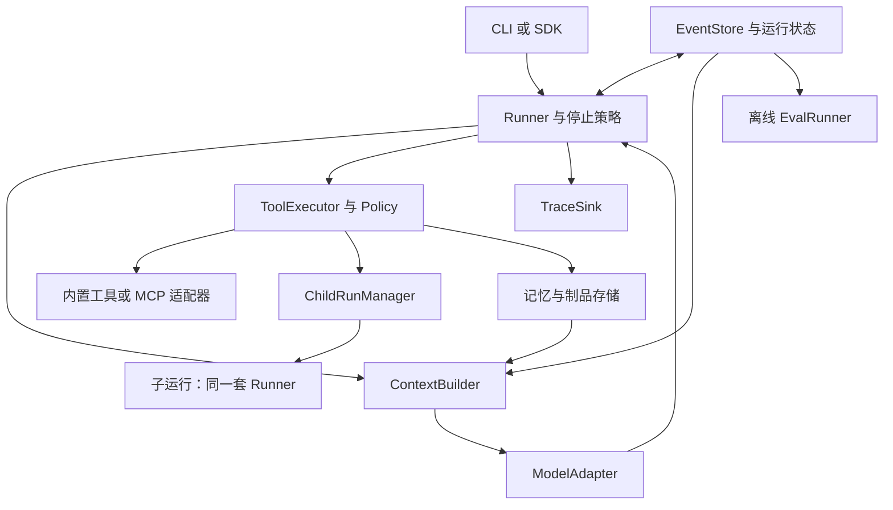

# 通用 Harness Agent 项目调研与孵化方案

调研日期：2026-11-24。目标是在本仓库中孵化可理解、可扩展、可评估的通用 Agent 运行时，覆盖 Loop、工具、记忆、上下文、评估、日志追溯与子 Agent，并持续向技术库沉淀实现经验。

## 1. 建议与选型结论

**整体主参考选择 DeepSeek Harness（dsh）；内核精读选择 Pi；Python 工程实现重点对照 OpenHands Software Agent SDK。** 这是针对本项目目标的设计判断，不是性能排名。

- **dsh 看整体边界**：插件组合、运行循环、会话事件、工具执行管线、压缩和子 Agent 如何协作，最贴近本次希望实现的完整 Harness。
- **Pi 看核心机制**：怎样把模型适配、消息、事件、工具执行、上下文投影拆开，便于自己掌握 Loop。
- **OpenHands SDK 看 Python 工程化**：会话、事件存储、上下文视图和执行环境如何解耦。
- **Deep Agents 做快速原型对照**：如果更看重交付速度，可直接基于其 Python SDK 构建；如果更看重掌握内核，则借鉴其中间件和后端边界。
- **Claude Code 做产品行为参考**：研究工具权限、上下文与子 Agent 的交互语义；其官方仓库使用商业条款，不能归入可直接复用内核的开放源码候选。

主参考的事实依据分别见 [dsh 架构](https://github.com/deepseek-ai/deepseek-harness/blob/4b399c39a6d1479cd84ca591b4d7c88e24d38a96/docs/architecture.md)、[Pi Agent Core](https://github.com/earendil-works/pi/blob/a588a7bc4d1bc16554ed2a8044fd4be72ce26ec9/packages/agent/README.md)、[OpenHands SDK](https://github.com/OpenHands/software-agent-sdk/blob/077f3fad6d31cd852be5c87176e0a93c3b446126/README.md)、[Deep Agents 架构](https://github.com/langchain-ai/deepagents/blob/084f04fe2951b6c69ae2f684fbc5af0e3765dbc3/libs/ARCHITECTURE.md) 和 [Claude Code 许可证](https://github.com/anthropics/claude-code/blob/50cdc7005318f630144c28217d1dada32e6ba762/LICENSE.md)。

**推荐孵化路线：自己实现小型内核，围绕稳定接口逐步增加能力。** 暂定 Python，理由是当前知识库和既有案例主要使用 Python，便于局部验证和反向积累；语言尚未由用户最终选定。如果最终选择 TypeScript，优先复用 Pi 包或直接开发 dsh 插件，再评估是否需要独立内核。

## 2. 调研范围与证据等级

本次阅读 9 个官方仓库的 33 份指定文档、源码及许可文件，并核对仓库默认分支、提交和许可元数据。准确范围与固定提交记录在 [调研来源快照](Harness调研来源快照.json)。源码链接固定在本次读取的提交，产品文档按访问日期记录。

证据分三类：**源码阅读**说明已检查指定实现；**仓库设计文档**说明维护者描述了对应架构；**产品文档**说明公开行为约定。它们都不等同于完成候选项目的部署或性能复现。本次没有安装这些项目的依赖、执行其 Agent、调用模型服务或复现公开榜单，因此不以 Star、宣传分数或“全部功能已验证”作选型依据。

下文“建议”“拟定”“验收”均为本项目的设计提案；项目现状的事实另附来源。复用代码时仍需核对具体文件和依赖的许可、保留声明，并记录版本。

## 3. 候选项目总览

| 项目 | 语言与本次核对的许可 | 在本项目中的位置 | 主要取舍 |
|---|---|---|---|
| [DeepSeek Harness](https://github.com/deepseek-ai/deepseek-harness) | TypeScript / MIT | 整体主参考 | 模块覆盖广；Cordis 插件体系有学习成本，官方标记为 developer preview |
| [Pi](https://github.com/earendil-works/pi) | TypeScript / MIT | 内核精读、TS 复用候选 | 必须区分 Agent Core、Coding Agent 和实验性 Durable 包 |
| [OpenHands Software Agent SDK](https://github.com/OpenHands/software-agent-sdk) | Python / MIT | Python 工程实现参考 | 优先读 SDK，而非从整个云端产品或 UI 入手 |
| [Deep Agents](https://github.com/langchain-ai/deepagents) | Python / MIT | 快速原型、上下文与中间件参考 | Loop 建立在 LangChain / LangGraph 之上，会引入对应依赖与语义 |
| [OpenCode](https://github.com/anomalyco/opencode) | 本次选读部分为 TypeScript / MIT | 会话、压缩及子任务产品化参考 | 当前快照已采用新的目录布局，旧教程路径可能失效 |
| [Codex](https://github.com/openai/codex) | Rust 核心 / Apache-2.0 | 权限、沙箱边界与记忆管线专项参考 | 工程规模大，适合按模块阅读，不适合首版整体移植 |
| [Gemini CLI](https://github.com/google-gemini/gemini-cli) | TypeScript / Apache-2.0 | 工具注册与工具发现的补充参考 | 本次仅选读工具注册实现，不对其全部 Harness 能力作判断 |
| [mini-swe-agent](https://github.com/SWE-agent/mini-swe-agent) | Python / MIT | 最小 Loop 与评估基线参考 | Bash 导向的简化设计不能直接覆盖本项目的全部能力 |
| [Claude Code](https://github.com/anthropics/claude-code) | 官方仓库受商业条款约束 | 产品与行为对标 | 公开仓库不等于开放源码许可；不据此推断内部实现 |

许可对应本次读取的官方仓库元数据与上述 Claude Code 许可文件，完整提交和核对入口见来源快照。dsh 的预览状态见其 [README](https://github.com/deepseek-ai/deepseek-harness/blob/4b399c39a6d1479cd84ca591b4d7c88e24d38a96/README.md)。

## 4. 重点项目：值得萃取什么

### 4.1 DeepSeek Harness：作为整体主参考

dsh 由 Cordis 组织插件，模型适配、工具注册、会话日志和默认 Loop 都可以通过配置组合。架构将持久会话事件、运行中的 Agent 事件、能力扩展事件分开；默认驱动明确区分 turn 与 step。这里的术语与 Pi 不完全相同，移植前要先定义自己的词汇。[架构与事件流](https://github.com/deepseek-ai/deepseek-harness/blob/4b399c39a6d1479cd84ca591b4d7c88e24d38a96/docs/architecture.md)

工具层区分模型可见 Schema 和宿主执行元数据；批次调度支持并发组与独占屏障，结果按模型调用顺序提交。取消时需要收敛已经启动的工作。适合萃取“工具定义 → 校验与策略 → 调度 → 执行 → 规范化结果”的管线，而非仅保存一个函数名称字典。[工具契约](https://github.com/deepseek-ai/deepseek-harness/blob/4b399c39a6d1479cd84ca591b4d7c88e24d38a96/docs/subsystems/tools.md)、[批次实现](https://github.com/deepseek-ai/deepseek-harness/blob/4b399c39a6d1479cd84ca591b4d7c88e24d38a96/packages/core/tools/src/batch.ts)

压缩是独立能力，保留持久事件来描述压缩的开始、摘要和结束；子 Agent 由 activation API 管理本地会话和外部执行，包含容量、结果交付与资源释放的契约；OTel 传输由独立插件承接。[压缩](https://github.com/deepseek-ai/deepseek-harness/blob/4b399c39a6d1479cd84ca591b4d7c88e24d38a96/docs/subsystems/compaction.md)、[子 Agent](https://github.com/deepseek-ai/deepseek-harness/blob/4b399c39a6d1479cd84ca591b4d7c88e24d38a96/docs/subsystems/subagent.md)、[OTel](https://github.com/deepseek-ai/deepseek-harness/blob/4b399c39a6d1479cd84ca591b4d7c88e24d38a96/docs/subsystems/otel.md)

**萃取建议**：借鉴服务契约、事件分类与生命周期所有权。首版先用简单注册表和显式依赖注入实现；待接口稳定后再引入插件装卸、配置层覆盖或热更新。仅凭插件可替换，不能证明跨会话长期记忆或评估质量已经满足我们的需求，这两项仍需独立设计与验证。

### 4.2 Pi：精读 Loop，而非把所有包混为一体

Pi 的 Agent Core 将应用消息转换为模型消息，提供流式事件和工具调用。实际 `runLoop()` 处理工具续轮、运行中 steering、结束后的 follow-up，以及 `finishTurn` 的继续或结束决定；长度截断下的工具调用会被记为失败，避免执行可能不完整的参数。[Agent Core 概念](https://github.com/earendil-works/pi/blob/a588a7bc4d1bc16554ed2a8044fd4be72ce26ec9/packages/agent/README.md)、[Loop 源码](https://github.com/earendil-works/pi/blob/a588a7bc4d1bc16554ed2a8044fd4be72ce26ec9/packages/agent/src/agent-loop.ts)

Coding Agent 的压缩以摘要和保留边界构造下一次上下文，原始记录仍保留，并明确避免从工具结果处切断调用关系。适合借鉴“完整历史与模型视图分离”，以及压缩失败、超窗重试的处理。[压缩文档](https://github.com/earendil-works/pi/blob/a588a7bc4d1bc16554ed2a8044fd4be72ce26ec9/packages/coding-agent/docs/compaction.md)

当前根 README 说明常规 Pi CLI 不默认提供子 Agent 和 plan mode；同仓库的 `pi-durable` 则另提供持久任务、恢复和子任务相关机制，且明确标记为实验性。不能将新实验包的功能无条件算到 Agent Core 或 CLI 默认能力上。[项目边界](https://github.com/earendil-works/pi/blob/a588a7bc4d1bc16554ed2a8044fd4be72ce26ec9/README.md)、[Durable 包](https://github.com/earendil-works/pi/blob/a588a7bc4d1bc16554ed2a8044fd4be72ce26ec9/packages/durable/README.md)

此外，Pi 将 telemetry 契约与具体后端分开，评估包将执行协议、计划运行和观察结果分别保存。这对我们统一追溯与实验产物有参考价值。[Telemetry](https://github.com/earendil-works/pi/blob/a588a7bc4d1bc16554ed2a8044fd4be72ce26ec9/packages/telemetry/README.md)、[Evals](https://github.com/earendil-works/pi/blob/a588a7bc4d1bc16554ed2a8044fd4be72ce26ec9/packages/evals/README.md)

**萃取建议**：先读 Core，再读 Coding Agent 压缩；Durable 作为第二阶段研究对象。Python 实现借鉴协议与控制流即可，不必通过子进程把 TS 内核强行包进首版。

### 4.3 OpenHands SDK：Python 的工程边界参考

SDK 将 Agent、Conversation、Tool、Workspace 和 Agent Server 划分为不同职责。`EventLog` 提供持久事件存储和并发写保护；上下文通过 View 应用压缩事件，避免删除原始事件历史。[SDK 边界](https://github.com/OpenHands/software-agent-sdk/blob/077f3fad6d31cd852be5c87176e0a93c3b446126/README.md)、[事件存储源码](https://github.com/OpenHands/software-agent-sdk/blob/077f3fad6d31cd852be5c87176e0a93c3b446126/openhands-sdk/openhands/sdk/conversation/event_store.py)、[Condenser](https://github.com/OpenHands/software-agent-sdk/blob/077f3fad6d31cd852be5c87176e0a93c3b446126/openhands-sdk/openhands/sdk/context/condenser/README.md)

**萃取建议**：让 Conversation 管状态、Agent 管决策与运行、Workspace 管执行环境。首版本地执行，之后再扩展隔离环境或远程 Workspace；避免让 Loop 到处直接操作磁盘、全局变量与网络连接。

### 4.4 Deep Agents：快速产品路线与中间件参考

`create_deep_agent()` 组装中间件并委托 LangChain 创建 Agent，执行状态由 LangGraph 承接。架构明确区分会话 checkpoint 和文件/记忆后端持久化；默认线程内后端不能自动视为跨线程永久存储。[构造源码](https://github.com/langchain-ai/deepagents/blob/084f04fe2951b6c69ae2f684fbc5af0e3765dbc3/libs/deepagents/deepagents/graph.py)、[持久化边界](https://github.com/langchain-ai/deepagents/blob/084f04fe2951b6c69ae2f684fbc5af0e3765dbc3/libs/ARCHITECTURE.md)

`MemoryMiddleware` 从配置的 `AGENTS.md` 来源加载内容并注入系统提示，不能直接等同于自动抽取事实的语义记忆系统。Evals 则记录工具调用、文件变更和最终回答，分别关注正确性与效率。[Memory 源码](https://github.com/langchain-ai/deepagents/blob/084f04fe2951b6c69ae2f684fbc5af0e3765dbc3/libs/deepagents/deepagents/middleware/memory.py)、[Evals](https://github.com/langchain-ai/deepagents/blob/084f04fe2951b6c69ae2f684fbc5af0e3765dbc3/libs/evals/README.md)

**萃取建议**：将请求上下文修改、工具执行拦截、记忆加载写成不同中间件；用后端接口决定数据生命周期。若选择直接依赖 Deep Agents，则接受其执行模型，避免再套一个互相竞争的外层 Loop。

### 4.5 其他专项参考

| 项目 | 已确认的可读机制与来源 | 本项目的萃取方向 |
|---|---|---|
| OpenCode | 当前 `packages/core` 内有 [压缩实现](https://github.com/anomalyco/opencode/blob/e1fb08afc547cd838ebc8ee7741d41d92edc0d6b/packages/core/src/session/compaction.ts) 和 [子会话报告实现](https://github.com/anomalyco/opencode/blob/e1fb08afc547cd838ebc8ee7741d41d92edc0d6b/packages/core/src/session/execution/subagent-report.ts)；官方文档描述独立上下文的子会话和结果报告。[Agent 文档](https://opencode.ai/docs/agents/) | 子任务结果交付、持续会话与用户操作之间的协调；不沿用旧版 `packages/opencode/src` 路径 |
| Codex | [Execpolicy](https://github.com/openai/codex/blob/af81d2770f1dd1d4d10a75e3f5e51596df7a905d/codex-rs/execpolicy/README.md) 定义命令策略；[Core](https://github.com/openai/codex/blob/af81d2770f1dd1d4d10a75e3f5e51596df7a905d/codex-rs/core/README.md) 说明平台沙箱；[Memories](https://github.com/openai/codex/blob/af81d2770f1dd1d4d10a75e3f5e51596df7a905d/codex-rs/memories/README.md) 将轨迹提取与记忆整合分为两阶段 | 策略决定与 OS 强制边界分离；记忆抽取与整合分离，不自动把所有聊天写成长期事实 |
| Gemini CLI | [ToolRegistry](https://github.com/google-gemini/gemini-cli/blob/eecccfcd5aff25de5e78135ca20f7abe3f566955/packages/core/src/tools/tool-registry.ts) 区分已知工具集合与活跃工具集合 | 注册、发现和当前模型可见工具分开，不把注册表全部暴露给每轮请求 |
| mini-swe-agent | [DefaultAgent](https://github.com/SWE-agent/mini-swe-agent/blob/04d809ceab9df28f9adaed044884180159172930/src/minisweagent/agents/default.py) 将运行、query、execute_actions、限制与轨迹保存分开；[README](https://github.com/SWE-agent/mini-swe-agent/blob/04d809ceab9df28f9adaed044884180159172930/README.md) 解释 Bash 导向的简化选择 | 做不带复杂记忆和编排的基线，比较新增机制是否真的带来收益；不直接照搬为首版默认 Shell 工具策略 |
| Claude Code | [工作方式](https://code.claude.com/docs/en/how-claude-code-works) 与 [子 Agent 文档](https://code.claude.com/docs/en/sub-agents) 描述工具循环、独立上下文、工具范围和结果回传；[许可](https://github.com/anthropics/claude-code/blob/50cdc7005318f630144c28217d1dada32e6ba762/LICENSE.md) 使用商业条款 | 研究用户可观察的语义与交互，不能将文档描述当成已阅读的内部源码 |

## 5. 七项能力如何转化为我们的模块

下表是拟定接口和实现要求，不是对候选项目的功能打分。

| 能力 | 建议模块 | 首版必须处理的边界 | 优先参考 |
|---|---|---|---|
| Loop | `Runner`、`RunState`、`StopPolicy` | 续轮、错误、取消、预算、长度截断；回答结束与任务完成分开 | Pi、dsh |
| 工具管理 | `ToolRegistry`、`ToolExecutor`、`Policy` | Schema 校验、可见性、授权、超时、结果大小、并发冲突 | dsh、Gemini CLI |
| 上下文 | `ContextBuilder`、`Compactor`、`ArtifactStore` | 按预算组装；保护工具调用配对；原始历史保留 | Pi、OpenHands、Deep Agents |
| 记忆 | `MemoryStore`、`MemoryRetriever`、写入策略 | 范围、来源、时间、冲突、更新、删除；与任务状态分开 | Codex、Deep Agents、仓库既有案例 |
| 日志与追溯 | `EventStore`、`TraceSink` | 同一运行内事件顺序；父子关系；失败也落盘；内容按配置留存 | dsh、Pi Telemetry、OpenHands |
| 子 Agent | `ChildRunManager`、`TaskResult` | 独立上下文、工具范围、预算、取消、结果摘要、等待语义 | dsh、OpenHands 结构、产品文档 |
| Agent 评估 | `EvalRunner`、`Evaluator`、数据集 | 结果评分与过程评分；失败运行不能消失；实验配置可重建 | Deep Agents Evals、Pi Evals、mini 基线 |

“通用”的初始含义建议限定为：模型适配可替换、工具可注册、任务类型可扩展、同一运行契约能服务不同应用。先用“仓库只读分析”和“隔离样例中的文件处理”两类任务验证；是否能迁移到检索或数据工具任务，要通过后续用例证明。

## 6. 拟定架构与关键数据契约

建议采用以下契约：

| 契约 | 建议关键字段或操作 | 用途 |
|---|---|---|
| `RunSpec` | 任务输入、模型配置、工具集合、工作区、预算、停止条件 | 固定一次运行的边界；配置带版本 |
| `RunState` | `pending/running/waiting/succeeded/failed/cancelled/limited` | 明确状态机；等待用户或子任务也有原因 |
| `HarnessEvent` | `schema_version/event_id/run_id/seq/type/parent_run_id/payload`，可选 trace 关联 | 结构化证据，支持迁移与状态恢复 |
| `ModelRequestSnapshot` | 系统指令、实际消息、工具 Schema、模型参数、上下文版本与内容引用 | 重建“模型到底看到了什么” |
| `ToolSpec` | 参数/结果 Schema、能力范围、并发类别、输出上限、重试属性 | 让执行策略由宿主管理，而非靠提示词约定 |
| `ToolCallRecord` | `call_id/status/args/result_ref/attempt`，副作用调用另带操作身份 | 区分未开始、执行中、已完成和结果不确定 |
| `MemoryRecord` | 内容、scope、来源事件、创建/更新时间、版本、状态 | 可追溯地维护跨会话知识 |
| `ChildTaskResult` | 状态、摘要、证据、制品引用、用量、失败原因 | 父运行按固定协议消费子任务结果 |

事件按 `run_id + seq` 排序，不依赖墙上时钟建立全局顺序。模型请求快照可以保存原文或受控内容引用；若配置不保留原文，就明确降低重建能力，不能只凭哈希声称完整可重放。

事件存储承载运行事实，Trace 提供耗时与关联视图，两者分开。诊断日志默认记录必要元数据；受控轨迹用于调试和评估。建议采用一个 SQLite 事件/状态后端作为首版权威存储，JSONL 作为导出格式，避免同时维护两套互相漂移的真相。

### Loop 与停止条件

拟定流程：输入与任务边界落盘 → 装配上下文 → 检查预算并请求模型 → 记录完整响应 → 校验并执行工具 → 记录结果 → 检查停止策略 → 继续、等待或结束。

必须单独处理：

1. 模型不再请求工具，表示当前生成完成；任务是否成功还需验收证据。
2. 用尽轮数、时间、Token 或成本预算，标记 `limited`，不标记成功。
3. 模型请求可按分类退避；有副作用工具不能因异常就无条件重试。
4. 取消后不启动新工作，已启动工作需要等待收敛；协作式取消不等于能强杀任意同进程代码。
5. 恢复时遇到“操作已发生但结果未落盘”，应保留结果不确定状态，先查询或交由策略处理。日志和 checkpoint 本身不保证外部副作用 exactly-once。

### 上下文与记忆

首版先区分四类数据：当前运行的工作上下文、任务进度与待办、跨会话记忆、文件与大结果制品。它们可以互相引用，但生命周期不同。

建议每次请求按“指令与任务边界 → 必要状态 → 检索到的记忆 → 历史摘要 → 近期完整消息 → 工具结果”组装，并根据模型能力配置总预算、输出预留和余量。先限制工具输出、把大结果转为可定位制品，再做历史压缩；保留最近的完整调用单元、未完成事项与用户约束。压缩失败时走明确的降级或失败路径。

长期记忆从项目级显式记录开始，可用 SQLite/文件和关键词检索，不强制首版引入向量数据库。后续增加候选事实抽取、冲突检测和整合；记忆必须有来源、scope、有效性与删除能力。读取历史事实不会自动产生新的工具授权。上述取舍也呼应 Anthropic 对长期任务交接制品及有限上下文持续筛选的讨论。[长期运行 Harness](https://www.anthropic.com/research/effective-harnesses-for-long-running-agents)、[上下文工程](https://www.anthropic.com/research/effective-context-engineering-for-ai-agents)

### 工具、插件与子 Agent

工具注册、模型可见和允许执行是三个独立判断。建议默认顺序执行；只读且明确可并发的工具再进入并发组，同一资源的写入使用锁或串行队列。MCP 只是工具来源适配器，也要经过相同的校验、权限、追溯与结果限额。

插件首版只开放模型适配、工具注册、中间件、记忆后端、Trace 导出和评估器这些接口。定义装载失败与释放规则后，再研究 dsh 的可逆注册和热更新；不一开始实现完整插件市场。

子 Agent 复用同一 Runner，使用独立上下文与运行身份，返回结构化结果。建议初始只支持单层、受限数量的子运行；权限取父级授权范围与子任务配置的交集，预留子预算且将真实用量汇总回根运行。取消需要沿子树传播，结束需要等待拥有的任务收敛。UI 可以显示实时进度，父 Agent 只消费摘要和证据引用。团队邮箱、递归委派和分布式调度放到后续阶段。

## 7. 两条可行实现路线

| 路线 | 适用目标 | 优势 | 成本与限制 |
|---|---|---|---|
| **A：独立 Python 内核，推荐** | 掌握 Harness、持续做技术积累 | 运行契约和学习路径可控；便于复用本仓库 Python 案例 | Loop、状态恢复、工具生命周期都需要自己实现并验证 |
| B：基于现有 Harness 扩展 | 尽快形成可用应用 | TS 可选 dsh 插件或 Pi SDK；Python 可选 OpenHands SDK / Deep Agents | 需要接受底层运行语义与升级节奏，沉淀重点转为扩展机制与应用评估 |

不建议首版同时接入多个完整框架作为可切换执行后端。先稳定自己对 Run、Event、Tool 和 Context 的定义；若以后需要比较执行后端，通过同一组任务和指标验证语义差异。

## 8. 孵化阶段与验收

以下是拟定范围，不是已实现能力，也不是工期承诺。

| 阶段 | 交付内容 | 退出条件 |
|---|---|---|
| P0：设计与基线 | 运行术语、数据契约、首批任务、模型模拟器 | 明确状态与完成条件；脚本化模型响应能驱动确定性测试 |
| P1：单 Agent 核心 | Loop、流事件、工具注册执行、预算、取消、SQLite 事件记录、最小 CLI | 多轮工具链可完成；截断/非法参数不误执行；有限预算必然终止；每次结束有状态与证据 |
| P2：上下文与恢复 | 请求快照、制品引用、上下文预算、压缩、checkpoint、显式项目记忆 | 压缩后调用配对有效；请求可重建；恢复不静默重复已完成的非幂等操作 |
| P3：子 Agent 与观测 | 子运行、容量与预算、结果交付、trace 导出 | 可取消与等待；父子用量可核对；失败和超时不会被包装为成功 |
| P4：评估与扩展 | 固定任务集、消融对比、MCP 适配器、更多模型协议 | 在同模型同任务下比较策略；失败、超时、用量和质量一并报告 |

评估从 P0 就开始，P4 扩展为系统实验。首版建议先完成 P1 的完整纵向链路，而不是七个目录各写一点。默认用模拟模型验证运行时，再由开发者配置凭据执行明确的在线验收。

首版暂缓：完整 GUI、插件市场、全自动长期记忆写入、多层 Agent 团队、分布式集群、全平台强隔离。Windows 上的路径、进程终止和文件锁要单独验证；本地工具策略不能冒充 OS 沙箱。

## 9. 评估方案：证明新增机制有效

建议建立两层验收，所有目标数值均为拟定要求。

**运行时契约层**：至少覆盖合法工具链、未知工具、参数错误、工具异常、输出截断、取消、预算耗尽、上下文压缩、持久恢复和子任务失败。这一层用模拟模型及可控工具，不需要模型裁判。检查事件顺序、调用配对、状态、不重复执行和用量归属。

**任务行为层**：先准备约 12 个小任务，覆盖仓库只读分析、隔离样例文件处理、跨会话记忆和子任务委派。每项有固定输入、允许工具、预算、制品要求和确定性验收器；确需语义判断时再引入模型裁判，保留裁判模型、提示词和输入版本。

| 维度 | 建议记录 |
|---|---|
| 完成与质量 | 有效终止率、任务通过率、制品与引用正确性；不能仅检查回答是否存在 |
| 运行可靠性 | 崩溃、恢复、死循环、调用配对错误、遗漏子任务、结果不确定次数 |
| 工具行为 | 参数错误率、拒绝原因、重复执行、超时、工具选择与顺序 |
| 资源效率 | 总用量、费用（价格版本与估算标记）、总时长、首事件延迟、压缩及子运行开销 |
| 记忆效果 | 有无记忆的任务通过率差异、错误引用、过期/冲突事实处理 |
| 可追溯性 | 请求快照覆盖、父子关联、事件缺口、失败轨迹完整度 |

比较顺序建议为：最小 Loop → 增加输出限额 → 增加压缩 → 增加记忆 → 增加子 Agent。固定模型、工具和任务集，每项做多次重复，至少报告样本量、分散程度及失败原因；首轮可先做 3 次以发现波动，不据此声称稳定性。超时、崩溃和缺失结果必须保留在运行清单中；单独区分评分缺失与任务失败，并报告分母，避免只统计成功轨迹。

每次实验保存运行协议、代码提交、模型与参数、任务与评分器版本、全部计划运行、观察结果和报告。轨迹数据用于实验；只有能跨任务复用、经过核对的结论才进入知识库。

## 10. 与现有仓库的关系及反哺方式

现有 [通用 Agent Harness 案例](../application/自动化与工具助手/通用AgentHarness/案例说明.md) 来自本地 learn-claude-code 快照，已有 s01–s17 的循环、权限、记忆、工作流和目标控制材料。它适合作为学习和对照来源，不应被覆盖成新项目；其 MCPClient 是协议替身，部分模块还含 Unix 依赖，复用前需核对。

建议未来新项目独立放在 **`incubator/agent-harness/`**，保留自己的 `pyproject.toml`、`src/`、`tests/`、`evals/`、`examples/` 和设计记录。本次只交付调研与方案，尚未创建运行时或将架构提案标记为可运行案例。开始实现时再把孵化目录纳入仓库维护规则和索引生成器。

建议按每个可验证能力形成以下积累：

| 项目产物 | 技术库沉淀 | 完成条件 |
|---|---|---|
| Loop 与停止策略 | 扩展 Agent 运行时主题，注明与现有教程差异 | 真实源码链接、状态边界、对应局部测试 |
| 工具契约与调度 | 权限与扩展主题 | 校验、并发、取消与副作用重试案例 |
| Context 与 Memory | 状态与记忆主题 | 上下文装配示例、错误案例、消融结果 |
| Trace 与 Evals | 调用追踪、效果评估主题 | 可复现协议、脱敏轨迹、评分边界 |
| Python 工程机制 | 更新既有知识点 | 只补充已实现的典型案例，不按项目重复建知识点 |

当前可复用的阅读入口包括 [模型与工具循环](../Python-appc/Agent运行时/Agent%20Harness模型与工具循环.md)、[工具权限](../Python-appc/权限与扩展/Harness工具权限判定.md)、[上下文压缩](../Python-appc/状态与记忆/Harness上下文压缩与调用结果配对.md)、[工作流恢复](../Python-appc/Agent运行时/Harness工作流日志缓存与恢复.md)、[目标与停止](../Python-appc/Agent运行时/Harness目标评估与停止控制.md) 和 [评估路线](Agent应用评估路线.md)。

本次源码对照还发现目标与停止文档的“评估前停止边界”错误引用了 `clear()`，已修正为真实的 `evaluate_after_turn()` 前置判断。这说明后续积累除了校验链接和行号范围，还应核对节选是否支持文字结论。

维护继续遵守 [维护规则](维护规则.md)：源代码与文档同批验证，索引自动生成，仅提交任务范围变更，推送后核对远程实际哈希。线上凭据、完整会话轨迹和临时评估输出按项目配置管理，不随知识文档无条件入库。

## 11. 建议的源码阅读顺序

1. **Pi Core**：`runLoop()`、工具批次与事件顺序；产出一张状态转换表。
2. **dsh**：架构 → `agent-loop/src/agent.ts` → `tools/src/batch.ts` → Session 与 Compaction 契约；产出模块责任与装卸边界表。
3. **OpenHands**：`Conversation` 边界说明 → `EventLog` → Condenser/View；产出权威状态与模型视图的映射。
4. **Deep Agents**：`create_deep_agent()` → memory/其他中间件边界 → evals；产出依赖与运行时自研成本对比。
5. **专项对照**：Codex 权限与记忆、OpenCode 子任务结果交付、Gemini 工具活跃集合、mini 基线。每次只解决一个明确设计问题。

完成上述阅读后，下一份设计文档应冻结 P1 的 `RunSpec / RunState / HarnessEvent / ToolSpec / ModelAdapter` 契约，并以一个可取消、可记录、可验收的单 Agent 工具任务作为首个里程碑。
