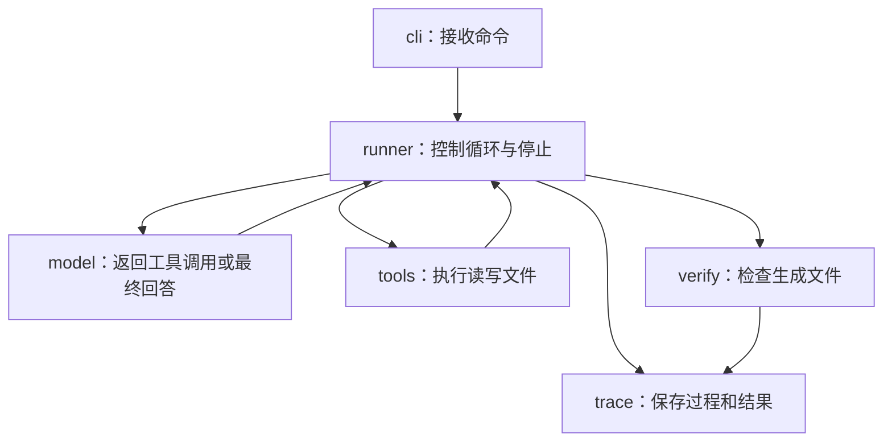

# MVP 设计

版本：v0.1 设计稿。日期：2026-11-24。本文定义本轮最小实现范围；当前尚无运行时代码。

## 1. 产品目标

做一个本地命令行程序：接收任务，让一个 Agent 调用文件工具完成任务；用户能够中止它、限制它、查看它做过什么，并由程序判断结果是否符合预期。

首版只需证明四件事：**停得下来、不会无限运行、过程查得到、结果验得出。**

| 用户需要 | 首版功能 | 用户看到的结果 |
|---|---|---|
| 执行任务 | 读取任务，循环调用模型和工具 | 终端逐步显示模型请求与工具执行进度 |
| 可取消 | Ctrl+C 停止当前运行 | 显示 `cancelled`，保留已完成步骤 |
| 有预算 | 限制模型调用、工具调用和总时长 | 达到限制显示 `limited` 和具体原因 |
| 可追溯 | 每次运行分配 ID，写入本地记录 | `show` 查看结果和步骤 |
| 可验收 | 用确定性规则检查输出 JSON | 显示 `passed` / `failed` 及检查明细 |

本轮交付 CLI、上述完整流程和自动测试。子 Agent、长期记忆、上下文摘要、插件、MCP、Shell、联网搜索、并发、断点续跑和 GUI 均留给后续版本。运行中只保留本次消息历史，历史增长超过输入限额就停止。

## 2. 第一条用户流程

以 [示例任务](../examples/demo/task.txt) 为贯穿案例：

1. 用户执行 `run --case examples/demo`。
2. 程序读取任务和预算，创建运行 ID。
3. Agent 调用 `read_file("brief.txt")`，读取案例的 `input/` 目录。
4. Agent 调用 `write_file("result.json", ...)`，写入这次运行的输出目录。
5. 模型给出最终回答，循环结束。
6. 验收器将生成 JSON 与预期 JSON 比较，终端显示运行状态、验收结果、用量和文件位置。

每个案例只需 `task.txt`、`input/` 和 `expected.json`。预期结果由验收器读取并保存副本，**不放进提示词，也不允许通过文件工具读取**。

终端输出示意，非实际运行结果：

```text
Run: demo-001
[1] model request
[1] read_file brief.txt -> ok
[2] model request
[2] write_file result.json -> ok
[3] model request -> final answer
Status: completed
Verification: passed
Model calls: 3/8 | Tool calls: 2/12
Output: .runs/demo-001/output/result.json
```

## 3. 架构：六个模块就够

技术选择：Python 3.11+，标准库优先；接真实模型时增加一个提供方客户端依赖。首版没有 Web 服务、数据库或外部日志平台。



| 文件（待开发） | 只负责什么 |
|---|---|
| `cli.py` | 解析 `run/show/verify` 命令、显示进度、接收 Ctrl+C |
| `runner.py` | 保存当前消息，驱动模型和工具，检查取消与预算，决定终态 |
| `model.py` | 统一模拟模型与一个真实模型的输入输出；负责关闭本次请求 |
| `tools.py` | 名称到函数的注册表、参数检查、路径限制和实际读写 |
| `trace.py` | 顺序写 JSONL 事件，落盘最终结果，读取历史运行 |
| `verify.py` | 检查结果文件、JSON 和字段，给出验收明细 |

代码未来放入 `src/harness_agent/`，使用 `__main__.py` 连接 CLI。需要打包时在 D1 创建 `pyproject.toml`。本次先创建文档和示例，避免大量空文件让人误以为功能已实现。

## 4. 功能怎么实现

### 4.1 Loop：模型决定下一步，程序负责执行

每次模型调用算一步，包括最终回答和失败的请求。模型返回以下两种结果之一：工具调用列表，或无工具调用的最终回答。一次可请求多个工具，但执行时始终串行。

```text
创建运行、记录任务与配置
重复：
  检查取消、时间、模型调用剩余额度、输入大小
  记录实际模型请求，增加模型调用计数，调用模型
  记录响应
  如果响应被截断或结构损坏：失败退出，不执行其中的工具
  如果没有工具调用：循环完成，开始验收
  否则按顺序处理每个工具调用：
    检查取消、时间与工具调用剩余额度
    校验工具和参数，执行工具，记录结果，加入消息历史
记录终态与验收结果，关闭资源
```

工具调用必须保留 `call_id`，结果对应原调用。未知工具或无效参数返回结构化错误给模型，允许下一步纠正；该次尝试也消耗工具额度。首版不自动重试模型请求和文件写入，避免隐藏额外调用。

所有“继续调用”只能由 Runner 发起，模型适配器与 SDK 关闭自动重试，避免预算之外的隐式请求。

### 4.2 工具：只提供两个

| 工具 | 输入 | 范围 | 返回 |
|---|---|---|---|
| `read_file` | 相对路径 `path` | 仅案例 `input/` 内的 UTF-8 普通文件 | 完整小文件文本或结构化错误 |
| `write_file` | 相对路径 `path`、文本 `content` | 仅本次 `.runs/<run_id>/output/` 内 | 已写入路径、字节数或结构化错误 |

参数类型和必填字段手工校验即可，无需引入通用插件或 Schema 框架。模型可见的参数 Schema 由这两份定义生成。工具名称、输入和执行结果均写入轨迹。

路径先解析再校验，拒绝绝对路径、`..`、符号链接及 Windows junction/reparse point 等可能越界的路径；对写入路径检查已有父目录。这里只提供小文件读写，不承诺 OS 级沙箱或抵抗其他进程恶意换路径。Windows 和 Linux 分别做路径测试。

单次读写上限初始设为 **16 KiB**，超过就返回明确错误，不把截断文件假装成完整输入。写入使用同目录临时文件加原子替换；取消不能撤销已经完成的写入。

### 4.3 预算：先把三项硬边界做好

| 参数 | 初始默认值 | 判定方式 |
|---|---:|---|
| `max_steps` | 8 次 | 每次模型请求前检查；最后一次也可正常给出最终回答 |
| `max_tool_calls` | 12 次 | 每个工具尝试前检查；错误尝试也计数 |
| `max_seconds` | 60 秒 | 单调时钟计算整个运行的剩余时间，包含自动验收 |

预算必须是正数，调用次数为正整数。剩余时间传给正在等待的模型请求；不能只在下一轮才发现当前请求已经超时。

另设 **32 KiB 模型请求大小上限**（按待发规范化请求 JSON 的 UTF-8 字节数计算，含指令、消息与工具定义），超过以 `limited / context_size` 停止；它是本地大小限制，**不是精确 Token 限额**。

Token 用量在提供方返回时记录，未提供就标记未知。本轮不承诺精确 Token 总预算或金额上限；模型调用次数与时长也不等于账单上限。

### 4.4 取消：先停止新动作，再收尾

Ctrl+C 转为取消请求，Runner 不再发起下一次模型或工具调用；对在途模型请求发出取消并关闭连接，在 `finally` 中保存结果与关闭日志。

小文件操作是短临界区，开始后可能先完成；记录其真实结果，不声称已回滚。等待外部请求的清理最多额外等待 3 秒，超出则记录 `cleanup_timeout` 后退出本地运行。这里的总时长是工作预算，清理时间另计；关闭客户端连接不能保证服务端立即停止生成或计费。

首版取消测试用可取消的模拟模型等待，目标 **1 秒内结束并落盘**。真实适配器必须使用异步请求并验证关闭行为，不用无法取消的后台线程冒充请求取消。强杀进程和断电后的恢复不属于本轮验收。

### 4.5 状态与验收分开

运行仅有 `running` 和四个终态：

| 终态 | 含义 |
|---|---|
| `completed` | 模型正常结束循环，并已完成本次验收尝试 |
| `failed` | 模型、轨迹写入或其他运行环节出错 |
| `cancelled` | 接收到用户取消 |
| `limited` | 预算或上下文大小达到边界 |

验收另外记录 `passed / failed / not_run`。**`completed` 不等于任务做对了**：文件内容错了，仍然是 `completed + verification.failed`。取消或超限时保留文件，但不执行自动验收，标记 `not_run`。

验收只做三步：`output/result.json` 存在 → 内容是合法 JSON → 对象与保存的 `expected.json` 完全一致（键顺序不影响，缺字段、多字段或值不同均失败）。预期结果本轮限定为字符串字段对象，避免引入类型强制转换。

无需另一个模型打分。只有 `completed + passed` 才算首个任务验收成功。`verify RUN_ID` 可离线重新检查文件，输出单独的复核报告，不改变原运行终态与原始验收记录。

### 4.6 轨迹：一行一件事

所有运行产物放在项目内被 Git 忽略的目录：

```text
.runs/<run_id>/
  events.jsonl          # 按 seq 排序的执行过程
  result.json           # 运行状态、原因、计数、回答、原始验收结果
  expected.json         # 本次验收标准副本，不传给模型
  output/result.json    # Agent 生成的业务结果
  verification-*.json   # 用户主动复核时才生成
```

事件字段只需 `version/run_id/seq/time/type/data`。事件类型先保留 `run.started`、`model.requested`、`model.responded`、`model.failed`、`tool.started`、`tool.finished`、`run.cancel_requested`、`verification.finished`、`run.finished`。是否达限和一般错误由最终结果中的 `reason` 说明。

请求事件记录实际模型、参数、消息与工具定义；响应事件记录响应和可用的用量；工具事件记录参数、结果和关联 ID。记录本地模型适配器及协议版本。不给凭据、鉴权头和环境变量写日志；任务与文件内容只进入本地受限大小的轨迹，不自动提交 Git。

单进程单写入者直接追加 JSONL，每条完整事件写完即 flush。`events.jsonl` 是过程记录，`result.json` 是最终摘要；后者通过临时文件替换保存。日志写入失败就停止执行新动作，返回失败，不能假称追溯完整。正常取消会收尾；强杀可能留下末尾残行或缺失终态，`show` 应提示记录不完整，不自动续跑。首版不声称崩溃事务或完整执行重放。

## 5. 命令与错误反馈

| 命令（待实现） | 功能 |
|---|---|
| `run --case examples/demo` | 默认模拟模型，执行并自动验收 |
| `run --case examples/demo --model api` | 显式使用真实模型；配置缺失时明确报错，不静默退回模拟模型 |
| `show RUN_ID` | 显示结果、预算、验收明细、模型与工具步骤 |
| `verify RUN_ID` | 使用这次运行保存的预期结果重新核对输出 |

CLI 退出码约定：`0` 表示本次执行或复核通过，`1` 表示运行/验收失败或超限，`2` 表示命令与配置错误，`130` 表示用户取消。`show` 成功读取记录时返回 `0`，不代表所查看的任务通过。终端和结果 JSON 都必须显示具体原因。

## 6. MVP 完成标准

| 编号 | 必须验证的场景 | 通过条件 |
|---|---|---|
| A01 | 正常工具链 | 读文件 → 写文件 → 最终回答；模拟任务 `completed + passed` |
| A02 | 模型无限要求继续 | 达模型调用上限就停止，不多发第 N+1 次请求 |
| A03 | 一次响应请求过多工具 | 达工具尝试上限后不启动下一个工具 |
| A04 | 模型持续等待 | 总时长到达后中止等待，以 `limited` 收尾 |
| A05 | 等待模型时按 Ctrl+C | 可取消模拟模型 1 秒内收尾，结果为 `cancelled` |
| A06 | 未知工具、缺参、类型错 | 工具不误执行，错误被记录；模型可在剩余额度内纠正 |
| A07 | 模型响应截断或损坏 | 不执行可疑工具参数，以 `failed` 收尾 |
| A08 | 绝对路径、越界路径、链接目录 | 拒绝访问；不修改外部文件 |
| A09 | 文件或请求过大 | 分别返回工具大小错误或以 `context_size` 达限停止 |
| A10 | 输出缺失、JSON 无效或字段错误 | 验收失败，列明失败项，不仅检查回答文字 |
| A11 | 过程可查看 | seq 连续、调用与结果关联、请求可读；show 能定位失败步骤 |
| A12 | 配置缺失与日志失败 | 请求前发现配置错误；日志失败后不继续执行新动作 |

先让以上场景离线自动通过，再做一次真实模型端到端验收。线上验收记录模型、参数、实际状态和制品；未执行就明确标记未执行。模拟通过不等于真实模型已通过。
