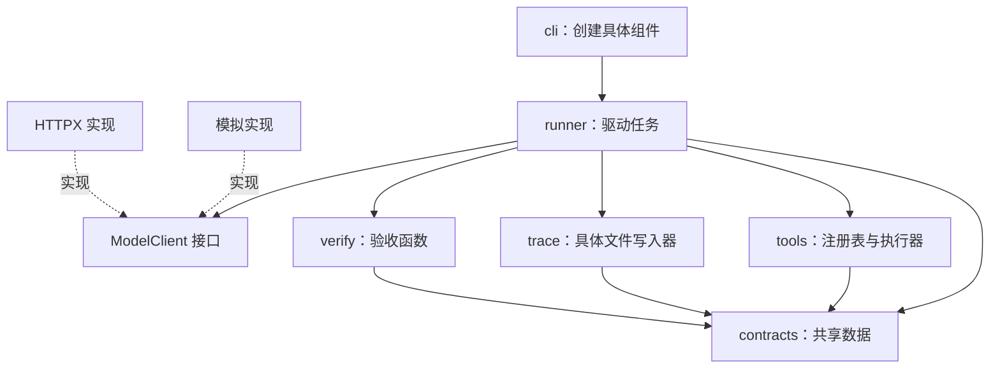

# 技术实现方案

版本：v0.1。日期：2026-11-24。状态：技术决策与接口设计，尚未实现运行时代码。

[MVP 设计](MVP设计.md) 定义产品做什么，本文定义用什么技术、代码怎样组织、关键功能怎样实现和验证；执行顺序见 [开发计划](开发计划.md)，实际进展见 [开发记录](开发记录.md)。本文细化当前 MVP，不增加长期记忆、子 Agent 等产品范围。

## 1. 先看结论

**Python 3.12 + asyncio + 标准库 CLI/文件存储；真实模型接入使用可选的 HTTPX。工程工具采用 uv、Ruff、mypy 和 unittest。**

第一条链路仍然只有：读任务 → 请求模型 → 执行两个文件工具 → 检查输出 → 保存结果。代码保持六个业务模块，增加一个只放共享数据契约的 `contracts.py`，避免模块相互循环导入。

核心离线运行不依赖第三方 Agent 框架。HTTPX 只在选择真实模型时加载；开发工具与打包工具不属于产品运行时依赖。

## 2. 技术选型原则

每项选择都按同一条顺序判断：**当前场景 → 必须满足的约束 → 最小合适方案 → 维护成本 → 验证方法**。新增依赖或更换技术时，在开发记录留下这五项，不以流行度或“以后可能需要”作为充分理由。

具体原则：

1. **先满足约束**：取消和超时要求网络等待可被取消；可追溯要求记录实际请求；验收要求结果可确定比较。
2. **读得懂优先**：核心控制流能按顺序阅读；普通函数和数据结构足够时，不引入框架生命周期。
3. **复用成熟基础设施**：网络传输、格式化和类型检查使用成熟工具，运行控制与业务语义由项目自己掌握。
4. **只抽象已存在的变化**：模拟与真实模型确实有两种实现，所以定义模型接口；只有一个文件存储时，先使用一个具体写入器。
5. **选型允许调整，但有触发条件**：发现真实约束变化后，用相同测试验证替代方案，再更新决策与实现。

以下理由属于针对本项目的工程判断；技术能力事实附官方来源。资料核对日期为 2026-11-24，不代表已安装或集成验证。

### 2.1 技术栈与理由

| 领域 | 本期选择 | 为什么适合当前场景 | 其他方案何时更合适 |
|---|---|---|---|
| 语言 | Python，最低 3.12，首版验收 3.12 | 当前库以 Python 为主，便于读源码、复用测试；3.12 提供 Windows junction 检查接口 | 产品主要复用 Pi/dsh 包或面向 JS 插件时重新比较 TypeScript；有性能实测瓶颈再评估 Rust |
| 执行模型 | `asyncio`，工具串行 | 网络请求可以等待、超时和取消，控制流仍保持一条主线 | 并行任务确有收益后增加受控并发，不预建分布式调度 |
| CLI | 标准库 `argparse` | 只有 run/show/verify，参数少，无需额外 CLI 框架 | 命令树或交互输入明显复杂后评估 Typer/Click |
| 数据契约 | `dataclasses`、类型标注、`Protocol` | 字段清楚；模拟与真实模型可以遵守同一接口 | 外部配置和嵌套结构明显增长后评估 Pydantic |
| 模型传输 | 可选依赖 `httpx.AsyncClient` | 当前只做一个文本/函数工具协议子集；能控制请求、响应大小、连接生命周期与测试替身 | 支持复杂流式协议、多个提供方特殊能力时，优先评估官方 SDK |
| 任务与产物 | UTF-8 文本、JSON、`pathlib` | 示例简单，便于直接打开阅读和确定性比较 | 大型配置、结构化检索或多媒体任务出现后另行设计 |
| 运行轨迹 | JSONL，单写入者；最终摘要 JSON | 单进程、无恢复要求，追加与查看足够 | 多写入者、事务、查询或恢复成为需求时迁移 SQLite |
| 环境与依赖 | uv、项目独立 `.venv`、`pyproject.toml`、`uv.lock` | 将本项目依赖与历史案例隔离；用锁文件重复安装 | 不建立整个技术库统一依赖环境 |
| 打包 | `src/` 布局、`uv_build` | 当前是纯 Python 包，与 uv 工具链和目录布局匹配 | 原生扩展或特殊构建流程出现后评估 Hatchling/其他后端 |
| 格式与检查 | Ruff + mypy | 分别处理格式/常见错误与静态类型问题，纳入同一 Python 工具环境 | 已有 Node 工程或团队统一使用 Pyright 时可重新评估，不同时运行两套类型检查器 |
| 测试 | `unittest`、`IsolatedAsyncioTestCase`、coverage.py | 标准库已支持异步测试；本期测试场景较小；额外测量分支覆盖 | 夹具和参数组合显著增多时评估 pytest，验收语义保持不变 |
| 持续集成 | GitHub Actions，Windows/Linux + Python 3.12 | GitHub 是当前协作端，两个系统覆盖信号与路径差异 | 本期不引入容器部署、服务编排或前端构建 |

当前环境已核对为 Python **3.12.8**，尚未发现 uv、Ruff、mypy 命令。该补丁号只是本次环境事实；D1 建环境时选择并记录经过验证的 3.12 补丁版本，不将本机旧补丁号直接当作长期标准。此前“3.11+”设计收敛为最低 3.12，主要为了减少 Windows 路径保护的兼容分支。[Python pathlib / is_junction](https://docs.python.org/3.12/library/pathlib.html#pathlib.Path.is_junction)

模型先使用自研脚本式模拟器；D4 接入一个经过兼容性验收的真实服务。协议选择为 **Chat Completions 风格的文本与函数工具调用子集**，不绑定具体模型名称，也不宣称所有“兼容”服务都可直接使用。服务地址、可用账号和模型名由部署配置提供，协议差异在适配器中处理。

### 2.2 依赖与版本管理

- 基础运行依赖为空；`api` 可选依赖包含 HTTPX。开发组包含 Ruff、mypy、coverage.py；构建后端为 uv_build。
- 本地分发名使用 `harness-agent`，导入模块为 `harness_agent`；孵化目录仍叫 agent-harness。这样与 uv_build 的默认名称规范化一致，避免目录名与包名混淆。
- D1 创建 `pyproject.toml`、`.python-version` 和 `uv.lock`；D4 增加 API 依赖并更新锁文件。本次不生成尚未经安装验证的依赖版本号或锁文件。
- 项目声明最低 Python 版本；本期 CI 认证 3.12。更高版本必须经过测试才能标记为已支持。
- 固定 uv 工具版本、Python 补丁版本及构建后端版本；构建后端使用已验证的精确版本约束。普通依赖声明受控范围，实际解析版本以提交的锁文件为准。
- CI 使用 `--locked`，配置与锁文件不一致时失败；升级在单独变更中说明原因并重新验证，不自动追随 latest。

uv 的项目、锁文件、同步与可选依赖行为见 [项目结构](https://docs.astral.sh/uv/concepts/projects/layout/) 和 [锁定与同步](https://docs.astral.sh/uv/concepts/projects/sync/)。uv_build 当前面向纯 Python 包，具体支持范围见 [构建后端文档](https://docs.astral.sh/uv/concepts/build-backend/)。这些能力与本项目的简单包结构相匹配，是本次选择依据。

## 3. 模块组织与依赖方向

以下目录是 D1 起逐步创建的目标结构，不是当前已存在的源码：

```text
agent-harness/
  pyproject.toml
  uv.lock
  .python-version
  src/harness_agent/
    __init__.py
    __main__.py      # 调用 CLI
    contracts.py    # 共享数据与模型接口
    cli.py          # 参数、装配、终端展示
    runner.py       # 唯一控制循环
    model.py        # 模拟与 HTTP 模型适配器
    tools.py        # 工具定义、校验、执行
    trace.py        # 过程与结果存储
    verify.py       # 确定性验收
  tests/
    test_runner.py
    test_tools.py
    test_trace.py
    test_verify.py
    test_cli.py
    test_model_api.py # D4 增加，默认仅测离线 HTTP 替身
  examples/demo/    # 已存在
  docs/            # 已存在
  .runs/           # 实现后生成，Git 忽略
```



依赖规则：

- CLI 是装配入口，决定使用哪个模型、哪些工具、哪个验收函数。Runner 不读取环境变量，不解析命令行。
- Runner 负责顺序、预算、状态与取消；其他组件不私自调用模型或启动下一轮。
- Model 不导入 Runner，不直接写文件或日志；它把请求/响应交给 Runner 记录。
- Tools 不调用模型；Verifier 不调用模型或修改结果文件；Trace 不决定业务状态。
- contracts 不导入上述业务模块。配置中的 API Key 留在模型适配器配置，不进入可序列化的 RunResult。

六个业务模块加一个共享契约文件，已经能表达这些边界；暂不增加多层 service/repository、依赖注入容器、插件加载器或通用事件总线。

## 4. 数据与接口契约

### 4.1 核心数据

| 契约 | 核心字段 | 约定 |
|---|---|---|
| `RunLimits` | max_steps、max_tool_calls、max_seconds、大小限额 | 构造时校验；调用计数拒绝 bool、零和负数 |
| `PreparedRequest` | adapter、model、body（JSON UTF-8 字节） | 已完成协议转换，不含鉴权；检查、记录与发送使用同一份 body |
| `ToolCall` | call_id、name、arguments | 同一次响应内 call_id 唯一；跨步骤以 step + call_id 关联 |
| `ModelResponse` | text、tool_calls、可选 usage | 正常最终回答与工具请求可辨认；损坏或截断响应不能进入工具执行 |
| `ToolResult` | call_id、ok、content、可选 error_code | 预期的工具错误也是结果；不依赖异常文字判断类别 |
| `VerificationResult` | passed/failed/not_run、检查明细 | 区分运行正常结束和任务做对了 |
| `RunResult` | version、run_id、status、reason、计数、回答、验收、待执行调用 | 终态只有 Runner 决定；输出为 JSON |

共享对象优先使用带类型的 dataclass；请求等输入使用不可变字段或复制后的集合。dataclass 和类型标注不替代外部数据校验：JSON、环境变量、模型响应和工具参数必须先验证再转换。[dataclasses](https://docs.python.org/3.12/library/dataclasses.html)

### 4.2 模型接口：只有必要的三个方法

以下是设计签名，相关类型尚待实现，不是可直接运行的代码：

```python
class ModelClient(Protocol):
    def prepare(
        self,
        messages: Sequence[Message],
        tool_schemas: Sequence[JsonObject],
    ) -> PreparedRequest: ...

    async def complete(self, request: PreparedRequest) -> ModelResponse: ...

    async def aclose(self) -> None: ...
```

`prepare` 纯转换；Runner 检查实际 body 大小并记录，然后调用 `complete`。这样不会出现“日志记录一种消息，适配器发送另一种消息”的偏差。完整 JSON 类型定义只放在 contracts，不把 `Any` 和任意 provider 对象传遍全项目。

使用 Protocol 是为了让两种已有需求的模型实现可以替换，不要求它们继承一个复杂基类。[Python Protocol](https://docs.python.org/3.12/library/typing.html#typing.Protocol)

### 4.3 其余扩展点保持简单

- 工具：`dict[str, ToolSpec]` 注册表。每个 ToolSpec 包含说明、参数表和处理函数。两项工具当前只有字符串参数，由同一份参数表生成模型 Schema 并完成必填、类型和额外字段校验，不做完整 JSON Schema 引擎。
- 验收：普通函数 `verify(output_dir, expected) -> VerificationResult`，作为参数传给 Runner。新增验收规则时替换函数，验收标准仍由宿主选择，不由模型修改。
- 存储：一个 `TraceWriter`，提供 `append`、`finish`、`close`。只有一个实现时不建立存储接口层；需要 SQLite 时再结合实际调用面提取契约。

新增一个模型或工具通常无需修改 Loop；但新能力如果改变取消、并发或完成语义，必须先改契约与测试，不能仅靠“注册成功”就宣称兼容。

## 5. 执行与停止的具体实现

### 5.1 一条主线

1. CLI 读取案例、检查配置及预期结果；创建运行目录，保存验收标准副本。默认模拟模式不需要密钥。
2. Runner 以 `loop.time()` 建立工作 deadline，记录 run.started，初始化三项预算计数。
3. 每次模型调用前检查预算，prepare 请求，检查请求大小，记录 model.requested，计数加一再发出请求。
4. 记录合法响应；按模型给出的顺序串行处理工具调用，每次尝试先检查工具预算、时间和参数。
5. 工具结果通过原 call_id 回填消息。未知工具和参数错误消耗一次工具尝试，但不执行处理函数。
6. 无工具调用且具有有效最终文本时，进入本地验收；空响应、拒绝/异常终止或不支持的响应类型由模型边界明确报错。
7. Runner 生成运行终态与验收结果，再由 TraceWriter 完成记录；关闭模型客户端和文件资源。

模型调用限额包括最终回答和失败请求。达到工具额度后，不启动后续处理函数；剩余调用标记为未执行，不制造 tool.started，也不计入已执行次数。已经开始的调用必须有结果或明确的中断记录。

### 5.2 超时与取消

外层用 `asyncio.timeout_at(deadline)` 约束工作阶段，底层 HTTP 客户端另设连接/读写超时。全局 deadline 到期是 `limited / max_seconds`；更早发生的网络连接超时是 `failed / model_timeout`，两者不能混为一谈。[asyncio timeout_at](https://docs.python.org/3.12/library/asyncio-task.html#asyncio.timeout_at)、[HTTPX 超时](https://www.python-httpx.org/advanced/timeouts/)

CLI 通过 asyncio 主任务处理 Ctrl+C。Runner 在明确边界处理 CancelledError，记录取消并清理，然后保留取消传播，让 CLI 返回 130；不在内部静默吞掉它。正常运行过程不用后台线程包同步 HTTP 请求。[Python 键盘中断处理](https://docs.python.org/3.12/library/asyncio-runner.html#handling-keyboard-interruption)

清理单独使用最多 3 秒的协作式超时，受控适配器必须正确响应取消；清理超时作为附加信息，不覆盖原始 cancelled/limited 原因。单进程不能强制终止任意阻塞代码：受限小文件 I/O 采用短同步操作，前后检查时间，在极慢磁盘上不能承诺精确抢占或严格墙钟上限。若以后需要强制结束不可信代码，再增加进程隔离，不能只靠 asyncio 声称实现。

### 5.3 错误分类

| 情况 | 表达方式 | 后续动作 |
|---|---|---|
| 命令、案例格式、缺少 API 配置 | `ConfigError` | 发请求前报错，退出码 2 |
| 未知工具、参数错误、普通文件错误 | `ToolResult(ok=False, error_code=...)` | 回填给模型，在剩余额度内纠正 |
| HTTP 错误、损坏响应、截断参数 | `ModelError`，含稳定的原因码 | failed，不执行该响应中的工具 |
| JSONL 或摘要写入失败 | `TraceError` | 停止新动作，终端报错；不能标记追溯完整 |
| 用户取消 | `CancelledError` | 记录、清理、继续向 CLI 传播 |
| 达到预算或请求大小限额 | Runner 的停止原因 | limited，保留已有产物 |
| 结果文件缺失或字段不符 | `VerificationResult(failed)` | completed + 验收失败，CLI 返回 1 |

小范围捕获预期异常；最终 CLI 边界兜底处理意外错误。禁止在工具中 `except Exception: return "成功"`，也不使用错误字符串是否包含某个词来控制流程。

## 6. 真实模型、文件和轨迹

### 6.1 HTTP 模型适配器

选择 HTTPX 的依据是它提供异步客户端、显式生命周期、分块读取与可替换 Transport，足以覆盖当前的一个薄协议适配器。[异步客户端](https://www.python-httpx.org/async/)、[Transport 与 MockTransport](https://www.python-httpx.org/advanced/transports/)

具体约束：

- 一个运行复用一个 AsyncClient，由适配器关闭。每次 complete 只发起一次业务请求，不自动重试、不自动跟随重定向。
- 首版等待完整 JSON 响应，暂不实现 SSE 或逐 Token 展示；终端展示步骤级进度即可。网络层仍分块读响应，以限制内容大小。
- 请求上限 **32 KiB**，按 PreparedRequest.body 的实际 UTF-8 字节计算，不含 HTTP 头；响应解码后累计上限 **64 KiB**，越界停止，不把截断结果交给工具。
- 验证响应结构、结束原因、函数名、call_id 和参数 JSON；不执行长度截断的工具调用。提供方返回的 Token 用量可记录，缺失就为未知。
- API Key、鉴权头和带凭据的配置不进入请求快照；HTTP 错误只记录经过筛选的状态码与诊断字段。
- 核心离线模块不在导入时依赖 HTTPX，选择 api 时才加载；未安装 api 依赖时明确提示，不悄悄切回模拟模式。

环境变量约定为 `HARNESS_API_URL`（完整接口地址）、`HARNESS_API_KEY` 和 `HARNESS_MODEL`。CLI 的 `--model mock/api` 选择适配器，HARNESS_MODEL 才是实际模型名。CLI 参数覆盖预算默认值。首版不自动读取 `.env` 文件；将来提供的 `.env.example` 只说明配置，不复制个人凭据。

D4 用离线 HTTP 替身检查请求体、工具回填、非 2xx、损坏 JSON、超时、取消、响应上限和“无重试”；再对选定服务做一次正常链路与一次真实取消验证。兼容性以结果为准，协议名字相似不能替代验收。

### 6.2 文件操作

案例 input 是只读根，本次 run/output 是写入根；task.txt 和 expected.json 不在工具可读区。任务和预期文件先限长再解析，上限均为 16 KiB；工具读写保持 MVP 的 16 KiB 上限。

路径校验独立成纯解析和文件属性检查步骤，拒绝绝对路径、盘符相对路径、UNC、`..`、Windows ADS 等不受支持写法；检查原始路径各已有组件的 symlink/junction/reparse 属性，再检查规范化目标属于允许根。读取最多 N+1 字节再判断大小，避免仅依赖预先 stat 的文件大小；写入先检查 UTF-8 字节数，再以同目录临时文件替换。

这些规则是有限工具面的路径保护，不是抵抗其他进程竞争修改目录的强沙箱。首版不启动 Shell，不让模型读取验收标准；不会为了扩展性提前开放任意路径和任意进程执行。

### 6.3 轨迹与验收

继续采用 MVP 的事件类型与 `.runs/<run_id>/` 布局。每条事件有版本、递增 seq 和时间；请求记录发送 body 的 UTF-8 内容，响应与工具结果按限额记录。普通终端进度不单独形成第二套业务事实，seq 而非时间决定本运行的事件顺序。

最终事件与 result.json 两份文件无法提供跨文件事务。finish 先写终态事件，再原子保存结果摘要；show 必须核对二者的 run_id、状态和最终 seq。任一缺失、不匹配或出现末尾残行，就标记“记录不完整”，不能展示为完整验收成功。落盘失败时 CLI 返回失败，即使业务文件已经生成。

验收器限长读取 output/result.json，检查是字符串字段对象，再与保存的 expected.json 完全比较；不依赖 JSON 键顺序。原验收结果不可被复核覆盖；verify 命令产生独立复核报告。本轮只支持一种验收规则，因此不建立通用评分框架。

## 7. 可读性、质量与扩展规则

### 7.1 代码怎样写才方便解析

- 使用清楚的领域名称，如 prepare_request、execute_tool、finish_run；避免泛化的 Manager/Engine/Helper 堆叠。
- 一个函数处理一个明确阶段，读取到副作用发生点应容易定位。Runner 保持顺序可读，不为机械行数限制拆成大量来回跳转。
- 对外函数和数据契约有类型标注；核心逻辑不使用 Any。外部 JSON 在边界作为未知数据检查，必要的类型收窄局限在解析函数。
- 文档字符串解释输入、输出、错误和取消语义；注释主要解释为什么这样做，关键实现给出一个小例子。
- 纯逻辑与 I/O 分开：参数检查、响应解析和验收比较尽量纯函数；网络、文件和日志在明确位置发生。
- 每次运行的状态由 Runner 独占，客户端和文件句柄有明确关闭者；不使用可变全局状态或导入时执行任务。
- 工具与模型的失败必须可追溯；不静默降级，不把模拟模式、Token 缺失或未执行验证包装成真实通过。

### 7.2 工程检查

| 检查 | 本项目要求 | 目的 |
|---|---|---|
| Ruff | 统一格式，启用 E4/E7/E9/F/I/B/UP；配置集中在 pyproject | 减少格式争议，检查明显错误、导入与常见陷阱 |
| mypy | src 与 tests 使用 strict；目标 Python 3.12；禁止显式 Any 与无原因的忽略 | 让接口变化与错误类型传递尽早暴露 |
| unittest | A01–A12 对应测试；异步用 IsolatedAsyncioTestCase，文件用临时目录 | 验证可观察行为和边界，避免只检查实现内部调用 |
| coverage.py | 启用分支覆盖；完整 MVP 项目覆盖指标至少 85% | 暴露遗漏分支；取消、预算、路径和日志失败还必须有明确用例 |
| CI | Windows/Linux 离线测试；不提供 API Key、不调用真实模型 | 不依赖外部服务稳定性，检查平台差异 |

Ruff 提供格式化和静态规则检查，mypy 支持 Python 类型检查与 strict 模式；这里将二者分工使用。[Ruff](https://docs.astral.sh/ruff/)、[mypy 安装与严格模式](https://mypy.readthedocs.io/en/stable/getting_started.html)

类型检查最初考虑 Pyright，核对其官方安装说明后确认 CLI 需要 Node，Python 包也会自动安装 Node。针对当前纯 Python 小项目，选择 mypy 可以减少一套执行环境的管理；这是场景取舍，不代表类型检查能力的通用排名。[Pyright 官方安装说明](https://github.com/microsoft/pyright/blob/main/docs/installation.md)

unittest 的异步测试类和 coverage 的分支测量可以支持本项目的测试方式。85% 是本项目拟定的最低指标，不是官方质量保证，也不能替代关键行为验收。[异步 unittest](https://docs.python.org/3.12/library/unittest.html#unittest.IsolatedAsyncioTestCase)、[分支覆盖](https://coverage.readthedocs.io/en/latest/branch.html)

CI 中测试任务取消，与真实键盘 Ctrl+C 分开：前者验证 Runner；Linux 可做子进程 SIGINT 测试；Windows 真实控制台 Ctrl+C 单独留下验证记录。链接目录测试若因平台权限无法创建必须明确跳过并补平台记录，不能悄悄当作测试通过。

## 8. 开发与验证落地

D1 创建工程和锁文件后，在项目根目录执行以下命令；**当前没有源码与工具安装，以下尚未运行**：

```powershell
uv sync --locked
uv run --locked ruff format --check src tests
uv run --locked ruff check src tests
uv run --locked mypy src tests
uv run --locked coverage run --branch --source=harness_agent -m unittest discover -s tests -v
uv run --locked coverage report --fail-under=85
```

首次建立锁文件由 D1 执行 uv lock；日常检查不隐式升级。D4 之后，API 离线测试的 sync 和每一条 run 都增加 `--extra api`，保证 HTTPX 始终按锁文件安装。CI 也采用同一参数集合，避免只在本机偶然存在依赖。

| 开发阶段 | 本技术方案要求补齐的内容 |
|---|---|
| D1 | Python 包、共享契约、模拟模型、两工具、最短 Loop；建立锁文件、Ruff/mypy/测试配置与项目 CI |
| D2 | deadline 与取消传播、大小限制、错误类型、路径边界；不依赖真实 API 验证这些契约 |
| D3 | 实际请求快照、日志失败与不完整记录识别、结果封存、验收和复核；完成覆盖率及平台检查 |
| D4 | 可选 HTTPX 适配器、离线协议测试、服务配置和两项在线验证；记录实际依赖与模型版本 |

每次提交先验证本项目，再运行仓库级索引与链接检查。检查范围只包含新项目与本次维护文档，不将整个历史案例库加入严格类型检查或格式化。实现产生的 pyproject、锁文件、CI 配置和测试结果才是“选型已落地”的证据；本文目前只代表已记录的技术实现基线。
