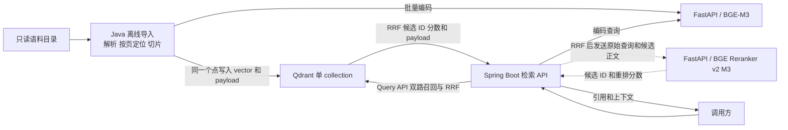

# 混合检索 RAG 落地方案

## 首版交付

在同一台机器上用 Docker Compose 启动 Java 检索 API、Qdrant、BGE-M3 编码容器和 BGE Reranker v2 M3 重排容器，运行一次 Java 离线导入。两个模型都在本机容器内加载权重并执行推理。用仓库自带的中英文示例语料调用 `POST /v1/search`，验收从编码、混合召回、RRF 到模型重排及引用输出的完整链路。首版固定语料快照，面向本地开发和单节点验收。原文归档和答案生成按独立里程碑扩展。



## 服务边界

| 模块 | 首版职责与实现 |
| --- | --- |
| `rag-api/` | JDK 21、Spring Boot、Maven Wrapper。同一个应用提供 `ingest` 命令与 HTTP 检索入口。LangChain4j 负责文档和切片模型、递归切片；文本型 PDF 采用逐页提取适配器，保留 PDF 的物理页码。Spring `RestClient` 调用编码器和 Qdrant。 |
| `encoder/` | Python 3.11、FastAPI、Pydantic、FlagEmbedding 与 PyTorch。编码器负责 tokenizer、模型加载、批处理和向量序列化。CPU 单 worker 是首个验收目标，GPU 作为后续独立部署配置。 |
| `reranker` | Python FastAPI 服务，在独立容器内运行 `BAAI/bge-reranker-v2-m3`，提供 `/rerank`。首版同样以 CPU 单 worker 验收。 |
| Qdrant | 单实例、单 collection，命名向量 `dense` 与 `sparse` 共用同一个点 ID。通过原生 REST Query API 下推两路召回和 RRF，Java 管理候选数、业务过滤、重排和上下文编排。 |

Java 应用按入口、导入与检索用例、客户端适配器组织。用 `EncoderClient`、`ChunkIndex` 作为外部依赖边界，测试可注入替身；Qdrant 请求对象留在适配器。Python 拆分 HTTP 请求模型、模型生命周期与编码实现，先维持单一 BGE-M3 后端。框架接口依据 [LangChain4j RAG 文档](https://docs.langchain4j.dev/tutorials/rag/) 和 [Qdrant Query API](https://api.qdrant.tech/api-reference/search/query-points/)。

## Python 编码契约

| 路由 | 请求与响应 |
| --- | --- |
| `POST /dense` | 接收 `{"texts":["..."]}`，逐项返回长度为 1024 的 `dense`。 |
| `POST /sparse` | 同一请求结构，逐项返回 `sparse`，形如 `{"indices":[14,71],"values":[0.2,0.8]}`。 |
| `POST /encode` | 同一请求结构，一次 BGE-M3 前向同时提取 `dense_vecs` 与 `lexical_weights`。Java 的双路导入和查询默认使用此路由。 |
| `GET /health/live`、`GET /health/ready` | 分别报告进程存活与模型可用性；就绪响应带可用于兼容检查的 `modelSignature`。 |

编码响应为 `modelSignature` 与 `items`，`items` 顺序与输入一致。稀疏索引使用 tokenizer 的整数 token ID，按 ID 排序，权重取有限浮点数；两数组等长，索引唯一。Java 校验返回条数、维度与签名。每批上限先设为 8 条，使用模型 tokenizer 对每条执行含特殊 token 的 1024 token 上限检查，超限返回 `422`。空字符串、空批次、超限与真实空稀疏向量分别处理。向量形状和输出字段依据 [BAAI/bge-m3 模型卡](https://huggingface.co/BAAI/bge-m3) 和 [Qdrant 向量说明](https://qdrant.tech/documentation/manage-data/vectors/)。

FastAPI 在 `lifespan` 中加载并预热一次模型，进程内限为一个执行中的推理批次，使用有界等候和忙时 `503`。阻塞推理放到工作线程，推理槽保留至实际计算结束；HTTP 请求超时只结束调用方等待。固定的模型签名涵盖模型与 tokenizer 修订、输出与归一化约定及推理精度。部署依据 [FastAPI 生命周期](https://fastapi.tiangolo.com/advanced/events/) 和 [进程内存说明](https://fastapi.tiangolo.com/deployment/concepts/#memory-per-process)。

## 离线导入与数据一致性

1. 从只读语料目录读取 UTF-8 TXT、Markdown 与文本型 PDF，按扩展名选择解析器。PDF 逐页提取，扫描 PDF 或空白解析结果明确报错；首版设置文件大小、总文件数与切片数上限。来源字段用语料相对路径，TXT、Markdown 用切片序号定位，PDF 用从 1 开始的物理页码和页内切片序号。
2. 对文档或 PDF 单页使用 LangChain4j 递归切片。初始参数为约 480 字符和 64 字符重叠，明确使用 Java 切片器的字符计量方式。编码前仍由 Python 执行模型 token 上限校验。以语料相对路径、文档内容摘要、定位和切片策略版本生成稳定的 UUID 点 ID，保留切片文本及来源。
3. 创建 `rag_chunks` collection，`dense` 用 1024 维 Cosine，`sparse` 用 BGE-M3 学得的词项权重，默认关闭 Qdrant IDF 修正。Java 将向量、正文和出处随同一个点写入，见下节。空稀疏向量只写 `dense`。初始化须检查现有 collection 的向量定义和元数据。
4. 用排序后的相对路径和文件摘要计算语料指纹，连同编码签名、切片策略版本写入 collection 元数据，初始状态为 `building`。单写入者批量 upsert 并使用 `wait=true`，以精确计数核对预期的点数，再写入 `ready`。同一指纹失败后重跑使用相同点 ID。在线服务只使用 `ready` 且签名匹配的索引。发现指纹或契约变化时中止导入，由显式重建流程发布新快照。首版使用停机重建，保留原索引备份以便回退；后续有不停机需求再设计别名切换。

导入持久状态与数据共存于同一个 collection。实现阶段需固定支持 collection 元数据读写的 Qdrant 版本，并以集成测试验证该协议。批写等待与元数据接口见 [创建 collection](https://api.qdrant.tech/api-reference/collections/create-collection)、[更新 collection](https://api.qdrant.tech/api-reference/collections/update-collection) 和 [upsert points](https://api.qdrant.tech/api-reference/points/upsert-points)。

## 切片落库与出处回读

每个切片对应一个 Qdrant point。Java 解析 PDF 时先确定物理页码，再对单页切片。编码器只接收切片正文并按批次输入顺序返回向量。Java 按同一批次序号把编码结果与原有出处合成一个 `Point`，一次 upsert 写入 `id`、`vector` 和 `payload`。同一文档的多个切片共用 `documentId`，各自有独立的点 ID。`page` 是从 1 开始的 PDF 物理页码，`chunkIndex` 从 0 开始，在 PDF 页内计数，在 TXT 和 Markdown 文档内计数。TXT 和 Markdown 省略 `page`。原文件保存在语料目录，检索所需的正文及出处随点保存于 Qdrant，首版可直接生成引用。[Qdrant Points](https://qdrant.tech/documentation/manage-data/points/)

`PUT /collections/rag_chunks/points?wait=true` 的示例请求。`dense` 数组仅展示前 3 个元素，实际写入 1024 维。

```json
{
  "points": [
    {
      "id": "f6f24fe9-a1ee-44dc-977e-ebdc99633ce7",
      "vector": {
        "dense": [0.012, -0.038, 0.021],
        "sparse": {"indices": [14, 71], "values": [0.2, 0.8]}
      },
      "payload": {
        "documentId": "refund-guide",
        "source": "policies/refund.pdf",
        "title": "退款规则",
        "page": 12,
        "chunkIndex": 2,
        "text": "审批通过后，退款将在五个工作日内原路退回。"
      }
    }
  ]
}
```

检索时，Java 在 Qdrant Query API 根请求中指定 `with_payload: ["documentId", "source", "title", "page", "chunkIndex", "text"]` 和 `with_vector: false`。Qdrant 返回的 `result.points[]` 每项含 `id`、`score` 和对应点的 `payload`。Java 将 `id` 映射为 `chunkId`，将 `payload.text` 用于重排或组装上下文，并从同一个 `payload` 读取定位。进入上下文的上述片段可生成 `[1] policies/refund.pdf，第 12 页`，`citations` 中对应条目同时保留 `chunkId` 和 `chunkIndex`，便于定位页内片段。整个回读随同一次检索响应完成。语料指纹、模型签名和导入状态仍保存在 collection 级 metadata 中，用于索引兼容检查。[Qdrant Query API](https://api.qdrant.tech/api-reference/search/query-points/)

## 在线检索与上下文

1. `POST /v1/search` 接收 `{"query":"...","topK":5}`，可选 `filters.documentIds`。拒绝空查询和超范围的 `topK`，首版范围为 1–20。Java 将同一过滤条件应用到每条召回支路，配置区分查询和导入的超时时间。
2. 单次 `/encode` 生成查询的两种向量。Java 向 `/collections/rag_chunks/points/query` 提交两个 `prefetch`，指定 `using: dense` 和 `using: sparse`，根查询使用 `{"fusion":"rrf"}`。初始默认每路取 30 条，融合后留 20 条，最终返回前 5 条。查询的稀疏向量为空时走 dense；依赖异常返回明确的错误，避免将故障误报为空结果。评估时通过相同适配器执行 dense-only 和 sparse-only 查询。 [Qdrant Hybrid Queries](https://qdrant.tech/documentation/hybrid-queries/)
3. Java 拿到 RRF 候选和 payload 后调用重排服务，再截取最终 `topK` 和拼上下文。D3 的检索基线直接采用 RRF 顺序。D4 完整部署默认启用重排，保留关闭重排的开关，用于对照评估。
4. Java 以稳定点 ID 去重，按排名在字符预算内拼接完整片段及 `[1]` 等局部引用标记，默认 4000 字符，引用头也计入预算。`hits` 返回候选展示所需的 `chunkId`、定位、正文、分数及 `scoreType`，`citations` 只包含进入 `context` 的片段。空结果返回空列表和空上下文。生成模型接入后再由其 tokenizer 计算实际提示词预算。

### 重排接入点（D4）

重排模型选定为 `BAAI/bge-reranker-v2-m3`，由 Python `reranker` 容器通过 FlagEmbedding 的 `FlagReranker` 加载，部署时固定模型 revision。启用后，Java 将原始 `query` 和融合候选的 `{chunkId, text}` 批量发送给内部 `POST /rerank`。服务对查询与每条候选正文联合编码，返回 `{chunkId, score}`。Java 按 `chunkId` 把分数关联回原候选，按分数降序取前 `topK`，同分保留输入顺序。来源、页码与正文随原候选进入最终上下文。重排超时或返回无效结果时保留候选原顺序并返回降级标记，评分类型仍反映实际采用的排序阶段。启用重排时，默认路径为 **dense 30 + sparse 30 → RRF 20 → 模型重排 20 → 最终 5 → 上下文与引用**。[BGE 重排模型卡](https://huggingface.co/BAAI/bge-reranker-v2-m3) · [仓库重排参考](../../../Python-appc/向量化与检索/BGE重排与多查询召回.md)

## Docker 部署

| 服务 | 启动与数据 |
| --- | --- |
| `qdrant` | 持久卷保存 collection，内部健康检查使用 `/readyz`。 |
| `encoder` | 在容器内加载固定 revision 的 `BAAI/bge-m3`，在 Compose 网络内提供 `/encode`、`/dense` 与 `/sparse`。 |
| `reranker` | 在独立容器内加载固定 revision 的 `BAAI/bge-reranker-v2-m3`，在 Compose 网络内提供 `/rerank`。 |
| `ingest` | 使用 Java 镜像的一次性任务，待 Qdrant 与编码器就绪后运行，语料目录只读挂载。 |
| `rag-api` | 使用同一个 Java 镜像，待 `ingest` 成功且所需模型服务就绪后启动。仅映射 `127.0.0.1:8080`，内部依赖用 Compose 服务名寻址。 |

完整交付在项目目录执行 `docker compose up --build --wait`，默认启动两个模型容器并启用模型重排。两套权重可在首次启动时下载至持久缓存卷，也可从本机只读挂载的固定 revision 快照加载。容器完成权重加载与预热后报告就绪，日志记录各自加载的模型 ID 和 revision。模型备齐后，编码与重排可在无外网环境下运行。

实现时用 `service_healthy` 和 `service_completed_successfully` 声明顺序，同时为 Java 配置应用层就绪检查和运行期依赖错误处理。固定镜像标签、Maven 依赖、Python 锁文件与模型 revision，提供 `.env.example`。请求日志记录请求 ID、耗时、批次大小和命中数，正文和向量留在业务存储。部署顺序见 [Docker Compose 启动顺序](https://docs.docker.com/compose/how-tos/startup-order/)。

## 开发与验收

| 里程碑 | 交付 | 验收 |
| --- | --- | --- |
| D1 编码契约 | FastAPI 三个端点、就绪检查、模型生命周期和假编码器测试 | 批量顺序、非法输入、模型过载、空稀疏与固定修订的真实 CPU 编码通过；同一输入的单路与组合输出在浮点容差内相符。 |
| D2 导入与检索 | Java CLI 与 HTTP API、Qdrant 适配器、具名索引与 RRF | 使用真实 Qdrant 和假编码器验证双路召回、过滤、重复导入、失败重跑与版本不匹配。用跨页出现相同正文的 PDF 验证点 ID 独立、payload 与命中 ID 一致，最终引用页码正确。 |
| D3 编码与检索 Compose 基线 | 固定依赖、示例语料、部署说明和检索回归 | 从空索引开始，用容器内真实 `BAAI/bge-m3` 完成导入和检索，验证前 5 条返回指定来源，PDF 引用页码正确。重启后索引保留，依赖失败时可定位。在标识符、改写、中文 PDF、过滤和受控无匹配样本上，记录各路召回与 RRF 的 Recall@5、MRR@5 和预热后 p95 延迟，注明语料规模、设备与样本数。 |
| D4 双模型 Compose 验收 | `BAAI/bge-reranker-v2-m3` 容器与完整本地部署 | 在同一次 Compose 运行中验证两个模型加载的 ID 和固定 revision，并通过 `POST /v1/search` 验证真实编码、RRF 后的模型重排已生效、返回的页码仍与正文对应。验证重排超时后回退 RRF，备齐权重后用缓存或本地快照完成无外网重启。用 D3 的标注查询比较加入模型重排前后的指标和延迟。 |
| 后续可选扩展 | PostgreSQL、生成适配 | 确需原文版本、ACL 或业务字段时引入 PostgreSQL，并定义索引重建与权限过滤。生成接入后验证证据忠实度和引用一致性。 |

每一阶段分别记录单元测试、服务集成和真实 Compose 验收的结果。D3 完成后记录编码与检索基线的运行方式，D4 完成后在 README 更新双模型部署命令和环境要求。已有关联资料和待回写知识点见 [开发记录](开发记录.md)。
