# 企业级 RAG 应用通用方案设计

> **文档定位**：以 RAG-Challenge-2 冠军工程为基石，提炼"最小必备原子流程 + 可插拔插槽"的通用 RAG 架构，
> 沉淀核心链路代码为参考手册，并推演三个差异化业务场景的落地变体。
>
> **目标读者**：技术负责人、算法工程师。所有论述锚定具体代码（文件/函数/行号），
> 代码均原样摘录自当前工程。

---

# 第一部分：现状拆解

## 1.1 完整 RAG 链路梳理

```mermaid
flowchart LR
    A["数据接入<br/>pdf_reports/*.pdf<br/>subset.csv 元数据"] --> B["文档解析<br/>PDFParser (Docling)<br/>JsonReportProcessor"]
    B --> C["内容规整<br/>PageTextPreparation<br/>过滤/组块/清洗"]
    C --> D["切分<br/>TextSplitter<br/>300tok/重叠50"]
    D --> E["Embedding<br/>VectorDBIngestor<br/>DashScope text-embedding-v1"]
    E --> F["向量存储<br/>FAISS IndexFlatIP<br/>每公司一个索引"]
    F --> G["检索<br/>VectorRetriever<br/>按公司路由+父文档检索"]
    G --> H["重排<br/>LLMReranker<br/>LLM分+向量分加权"]
    H --> I["上下文组装<br/>_format_retrieval_results"]
    I --> J["LLM 生成<br/>APIProcessor<br/>SO CoT 提示词"]
    J --> K["输出校验<br/>引用页码校验<br/>提交格式后处理"]
```



| 环节 | 实现方式 | 关键代码位置 | 可配置项 |
|---|---|---|---|
| 数据接入 | PDF 目录 + subset.csv 公司元数据 | `pipeline.py:34` `PipelineConfig` | 目录名、文件名 |
| 文档解析 | Docling StandardPdfPipeline（OCR + TableFormer） | `pdf_parsing.py:57` `PDFParser`；`pdf_parsing.py:287` `JsonReportProcessor` | 后端、线程数 |
| 表格序列化 | LLM 把表格拆为上下文独立信息块 | `tables_serialization.py:52` `TableSerializer` | 模型、并发 |
| 内容规整 | 页脚过滤/表格组列表组合并/OCR 字符清洗 | `parsed_reports_merging.py:27` `PageTextPreparation` | 是否用序列化表格 |
| 切分 | RecursiveCharacterTextSplitter（tiktoken 计数） | `text_splitter.py:84` `_split_page` | chunk_size=300、overlap=50 |
| Embedding | DashScope text-embedding-v1，分批 25 | `ingestion.py:83` `_get_embeddings` | 模型、批次 |
| 向量存储 | FAISS IndexFlatIP，每公司独立 .faiss | `ingestion.py:139` `_create_vector_db` | 距离度量 |
| 检索 | 公司名路由 → query embedding → top_n；可返回父文档整页 | `retrieval.py:248` `VectorRetriever.retrieve_by_company_name` | top_n、PDR 开关 |
| 重排 | LLM 相关性分与向量分加权融合 | `reranking.py:167` `LLMReranker.rerank_documents` | 权重 0.7、batch 大小 |
| 上下文组装 | 检索页拼成 `Text retrieved from page N: """..."""` | `questions_processing.py:89` `_format_retrieval_results` | — |
| LLM 生成 | 按 kind 路由 SO CoT 提示词，多 provider 适配 | `api_requests.py:441` `get_answer_from_rag_context`；`prompts.py` 全部 | provider、模型 |
| 输出校验 | 幻觉页码剔除 + 1-based→0-based + N/A 清空引用 | `questions_processing.py:120` `_validate_page_references`；`questions_processing.py:452` `_post_process_submission_answers` | min/max 页数 |

## 1.2 薄弱环节与缺失环节（含代码证据）

| # | 问题 | 代码证据 | 影响 |
|---|---|---|---|
| 1 | **无重排策略抽象**：LLMReranker 与 HybridRetriever 硬编码耦合，JinaReranker 写了但从未接入主流程 | `retrieval.py:343` `HybridRetriever.__init__` 直接 `LLMReranker()`；`reranking.py:25` `JinaReranker` 无调用方 | 换重排模型需改两处 |
| 2 | **dashscope 降级路径丢失结构化输出**：分数/推理字段靠文本解析兜底 | `api_requests.py:697` `BaseDashscopeProcessor.send_message` 注释"暂不支持结构化输出"；`reranking.py` dashscope 分支返回占位 `relevance_score: 0.0` | 重排退化为纯向量排序（实测仍 13/13，但浪费了 LLM 打分） |
| 3 | **无在线评测与监控**：只有批处理结束后的统计打印 | `questions_processing.py:284` `_calculate_statistics` 仅 total/error/N/A 计数 | 无法感知逐题准确率与检索质量漂移 |
| 4 | **无缓存层**：同一问题重复调用全链路（embedding+检索+LLM） | 全代码库无 cache 相关实现（已检索确认） | 成本与时延浪费 |
| 5 | **解析与问答耦合在 Pipeline 类**：阶段方法直接实例化具体类 | `pipeline.py:94` `Pipeline` 各方法内 `new PDFParser()` / `new VectorDBIngestor()` | 不利于替换实现（本报告第四部分给出改造路径） |
| 6 | **表格序列化依赖 OpenAI**：全国内链路下的断点 | `tables_serialization.py:133` `_send_serialization_request` 中 `model='gpt-4o-mini-2024-07-18'` 硬编码 | 无 OPENAI_API_KEY 时完整流程跑不通 |
| 7 | **单点失败无重试**（问答阶段）：仅 embedding 有 tenacity 重试 | 对比 `ingestion.py:82`（`@retry`）与 `api_requests.py:697`（无重试装饰器） | API 抖动直接造成单题失败 |
| 8 | 中文路径兼容性：FAISS 打不开非 ASCII 路径 | `retrieval.py:31` `_faiss_read_index`（本次修复加的临时目录复制方案） | 已实现修复，但属于平台适配债 |

---

# 第二部分：核心链路代码整理（代码参考手册）

> 摘录优先级：检索与上下文组装 > Embedding 与向量存储 > 文档解析/切分 > 生成调用。
> 行号对应注释完善后的当前版本。

## 2.1 检索与上下文组装（最高优先级）

### 2.1.1 向量检索器：加载与检索

**功能定位**：问答链路的核心。启动时把"每公司一份的 (文档JSON, FAISS索引) 对"全部载入内存；
检索时按公司名定位报告，对问题做 embedding 后在对应索引中取 top_n，可选父文档检索（返回整页）。

**核心代码**（`src/retrieval.py`）：

```python
# L122-L137  初始化：加载所有库，按公司名建立映射
class VectorRetriever:
    """向量检索器：加载所有（文档 JSON + FAISS 索引）对，按公司名检索 top_n。..."""
    def __init__(self, vector_db_dir: Path, documents_dir: Path, embedding_provider: str = "dashscope"):
        self.vector_db_dir = vector_db_dir
        self.documents_dir = documents_dir
        self.all_dbs = self._load_dbs()          # 启动时一次性全量加载
        self.embedding_provider = embedding_provider.lower()
        self.llm = self._set_up_llm()

# L199-L236  加载逻辑：文件名（sha1）配对，校验 schema
    def _load_dbs(self):
        all_dbs = []
        all_documents_paths = list(self.documents_dir.glob('*.json'))
        vector_db_files = {db_path.stem: db_path for db_path in self.vector_db_dir.glob('*.faiss')}
        for document_path in all_documents_paths:
            stem = document_path.stem
            if stem not in vector_db_files:
                _log.warning(f"No matching vector DB found for document {document_path.name}")
                continue
            # ... 打开 JSON、校验结构、读 FAISS ...
                vector_db = _faiss_read_index(vector_db_files[stem])   # L224 中文路径兼容读取
            # ...
            all_dbs.append({"name": stem, "vector_db": vector_db, "document": document})
        return all_dbs

# L248-L310  检索主逻辑
    def retrieve_by_company_name(self, company_name, query, llm_reranking_sample_size=None,
                                 top_n=3, return_parent_pages=False):
        target_report = None
        for report in self.all_dbs:
            metainfo = report.get("document", {}).get("metainfo")
            if metainfo.get("company_name") == company_name:   # 公司名精确路由
                target_report = report
                break
        if target_report is None:
            raise ValueError(f"No report found with '{company_name}' company name.")
        document = target_report["document"]
        vector_db = target_report["vector_db"]
        chunks = document["content"]["chunks"]
        pages = document["content"]["pages"]
        embedding = self._get_embedding(query)                  # DashScope text-embedding-v1
        embedding_array = np.array(embedding, dtype=np.float32).reshape(1, -1)
        distances, indices = vector_db.search(x=embedding_array, k=actual_top_n)  # L287 FAISS 内积
        # 命中 chunk 后按 return_parent_pages 决定返回 chunk 还是所属整页（父文档检索）
```

**设计要点**：
- **每公司独立库**而非全库+过滤：检索空间天然隔离，杜绝跨公司串扰（对应 N/A 防幻觉需求）；
- FAISS 用 `IndexFlatIP`（内积），前提是 embedding 已归一化——DashScope text-embedding-v1 输出即归一化向量，故内积=余弦相似度；
- `return_parent_pages=True` 时按页去重返回整页文本，是比赛场景的关键提分手段。

**扩展指南**：换向量库（如 Milvus/Qdrant）时替换 `_load_dbs` 与 `vector_db.search` 两个接口即可，
上层 `HybridRetriever`/`QuestionsProcessor` 无需改动；增量化加载（懒加载）可在 `_load_dbs` 中
改为返回句柄、首次检索时再读。

### 2.1.2 中文路径兼容读取

**核心代码**（`src/retrieval.py:31-53`）：

```python
def _faiss_read_index(path):
    """读取 FAISS 索引，兼容 Windows 中文路径。
    FAISS 底层用 fopen（ANSI 代码页）打开文件，遇到中文等非 ASCII 字符的路径
    会报 "could not open ... for reading" ... 先把索引文件复制到系统临时目录
    （纯 ASCII 路径），再让 FAISS 读取副本。"""
    path_str = str(path)
    if os.name == "nt":
        try:
            path_str.encode("ascii")
        except UnicodeEncodeError:
            import tempfile, shutil
            cache_dir = os.path.join(tempfile.gettempdir(), "rag_faiss_cache")
            os.makedirs(cache_dir, exist_ok=True)
            cached = os.path.join(cache_dir, os.path.basename(path_str))
            if not os.path.exists(cached) or os.path.getsize(cached) != os.path.getsize(path_str):
                shutil.copyfile(path_str, cached)
            path_str = cached
    return faiss.read_index(path_str)
```

**扩展指南**：迁移到 Linux 部署时此函数自动失效（`os.name != "nt"` 直通），无需删除；
若换用支持 Python 文件对象的向量库，整体删除即可。

### 2.1.3 LLM 重排

**核心代码**（`src/reranking.py:167-224`）：

```python
    def rerank_documents(self, query: str, documents: list, documents_batch_size: int = 4, llm_weight: float = 0.7):
        doc_batches = [documents[i:i + documents_batch_size] for i in range(0, len(documents), documents_batch_size)]
        vector_weight = 1 - llm_weight
        # ...
        def process_batch(batch):
            texts = [doc['text'] for doc in batch]
            rankings = self.get_rank_for_multiple_blocks(query, texts)
            # ...
            for doc, rank in zip(batch, block_rankings):
                doc_with_score = doc.copy()
                doc_with_score["relevance_score"] = rank["relevance_score"]
                doc_with_score["combined_score"] = round(
                    llm_weight * rank["relevance_score"] + vector_weight * doc['distance'], 4)
                results.append(doc_with_score)
        # ...
        all_results.sort(key=lambda x: x["combined_score"], reverse=True)
        return all_results
```

**设计要点**：加权融合公式 `combined = 0.7×LLM相关性 + 0.3×向量内积`，LLM 分主导、向量分兜底；
batch 模式（多块一次调用）比单块模式省 60-80% 调用量。

**扩展指南**：接入 BGE/Cohere 等交叉编码器时，实现同签名类（`rerank(query, documents) -> scored list`），
在 `retrieval.py:350` `HybridRetriever.__init__` 处替换 `LLMReranker()` 为工厂选择。

### 2.1.4 上下文组装

**核心代码**（`src/questions_processing.py:89-99`）：

```python
    def _format_retrieval_results(self, retrieval_results) -> str:
        """将检索结果格式化为RAG上下文字符串"""
        if not retrieval_results:
            return ""
        context_parts = []
        for result in retrieval_results:
            page_number = result['page']
            text = result['text']
            context_parts.append(f'Text retrieved from page {page_number}: \n"""\n{text}\n"""')
        return "\n\n---\n\n".join(context_parts)
```

**设计要点**：每段标注来源页码（`Text retrieved from page N`），既方便 LLM 填 relevant_pages，
也让人工核对时能直接翻页。分隔符与 prompts.py 的 `---` 风格统一。

**扩展指南**：需要控制上下文长度时，在此函数加入 token 预算裁剪（按 `result` 顺序截断或摘要压缩），
这是接入长上下文模型的最佳切入点。

## 2.2 Embedding 与向量存储

**核心代码**（`src/ingestion.py`）：

```python
# L83-L116  分批 + 重试的 embedding 调用
    @retry(wait=wait_fixed(20), stop=stop_after_attempt(2))
    def _get_embeddings(self, text, model: str = "text-embedding-v1"):
        # 类型检查、过滤空串 ...
        embeddings = []
        MAX_BATCH_SIZE = 25
        for i in range(0, len(text_chunks), MAX_BATCH_SIZE):
            batch = text_chunks[i:i+MAX_BATCH_SIZE]
            resp = TextEmbedding.call(model=TextEmbedding.Models.text_embedding_v1, input=batch)
            # 兼容单条/多条两种返回格式，空向量写日志并抛错
        return embeddings

# L139-L145  FAISS 建索引
    def _create_vector_db(self, embeddings: List[float]):
        embeddings_array = np.array(embeddings, dtype=np.float32)
        dimension = len(embeddings[0])
        index = faiss.IndexFlatIP(dimension)  # Cosine distance（内积，依赖向量已归一化）
        index.add(embeddings_array)
        return index

# L154-L168  批量入库：每份报告一个 .faiss
    def process_reports(self, all_reports_dir: Path, output_dir: Path):
        for report_path in tqdm(all_report_paths, desc="Processing reports"):
            with open(report_path, 'r', encoding='utf-8') as file:
                report_data = json.load(file)
            index = self._process_report(report_data)
            sha1_name = report_data["metainfo"]["sha1_name"]
            faiss.write_index(index, str(output_dir / f"{sha1_name}.faiss"))
```

**设计要点**：分批 25 是 DashScope 单次调用上限附近的经验值；`@retry` 只加在建库侧（建库可重跑），
问答侧靠批内断点保存兜底。

**扩展指南**：换 embedding 模型时改 `model` 参数并重建全部索引（向量空间不兼容，不可混用）；
数据量增大后把 `IndexFlatIP` 换 `IndexIVFFlat`/`HNSW`，在 `_create_vector_db` 一处改动。

## 2.3 文档解析与切分

### 2.3.1 分块（`src/text_splitter.py:84-98`）

```python
    def _split_page(self, page: Dict[str, any], chunk_size: int = 300, chunk_overlap: int = 50) -> List[Dict[str, any]]:
        """将单页文本分块，保留原始markdown表格。"""
        text_splitter = RecursiveCharacterTextSplitter.from_tiktoken_encoder(
            model_name="gpt-4o", chunk_size=chunk_size, chunk_overlap=chunk_overlap)
        chunks = text_splitter.split_text(page['text'])
        chunks_with_meta = []
        for chunk in chunks:
            chunks_with_meta.append({
                "page": page['page'],
                "length_tokens": self.count_tokens(chunk),
                "text": chunk
            })
        return chunks_with_meta
```

**设计要点**：300/50 的取值配合父文档检索——块只负责"召回定位"，真正喂给 LLM 的是整页，
故块可以偏小换取召回精度。若不用 PDR，应增大到 500-800。

### 2.3.2 解析器（`src/pdf_parsing.py:57-68`，签名与装配）

```python
class PDFParser:
    def __init__(self, pdf_backend=DoclingParseV2DocumentBackend,
                 output_dir: Path = Path("./parsed_pdfs"),
                 num_threads: int = None, csv_metadata_path: Path = None):
        self.pdf_backend = pdf_backend
        self.output_dir = output_dir
        self.doc_converter = self._create_document_converter()
        # _create_document_converter: do_ocr=True(EasyOCR) + TableFormerMode.ACCURATE
```

**扩展指南**：轻量场景（纯文本 PDF）可把 `pipeline_options.do_ocr=False`、`do_table_structure=False`
换取 10 倍以上速度；扫描件场景保持现状。

## 2.4 生成调用

**核心代码**（`src/api_requests.py:441-471`）：

```python
    def get_answer_from_rag_context(self, question, rag_context, schema, model):
        """【流程步骤 6.4】RAG 回答：按 schema(kind) 组装 SO CoT 提示词 -> 调 LLM -> 字段兜底。"""
        system_prompt, response_format, user_prompt = self._build_rag_context_prompts(schema)
        answer_dict = self.processor.send_message(
            model=model,
            system_content=system_prompt,
            human_content=user_prompt.format(context=rag_context, question=question),
            is_structured=True,
            response_format=response_format
        )
        self.response_data = self.processor.response_data
        # 假如 answer_dict 只有 final_answer，自动兜底
        if 'step_by_step_analysis' not in answer_dict:
            answer_dict = {"step_by_step_analysis": "", "reasoning_summary": "",
                           "relevant_pages": [], "final_answer": answer_dict.get("final_answer", "N/A")}
        return answer_dict
```

**设计要点**：provider 路由（`APIProcessor.__init__`，L402）把 OpenAI/IBM/Gemini/DashScope 四家的差异
封装在统一 `send_message` 签名下；`_build_rag_context_prompts`（L473）按 kind 五选一提示词，
并对 ibm/gemini 切换"文本 schema 版"系统提示词。

**扩展指南**：接入国产新模型（如 DeepSeek/GLM）时新增一个 `BaseXxxProcessor` 实现 `send_message`
并在 `APIProcessor.__init__` 注册分支即可，上层零改动——这是本工程最值得保留的模式。

---

# 第三部分：核心抽象

## 3.1 最小必备原子流程（任何场景不可省略）

从当前链路提炼出 6 个原子环节。**判定标准：去掉它，系统就不再是"基于知识的问答"。**

| # | 原子环节 | 为什么不可省略 | 省略后果 | 当前实现映射 |
|---|---|---|---|---|
| A1 | **知识装载**（文档→结构化文本） | LLM 只能消费文本，原始 PDF/网页/Word 必须被解析为带结构语义的文本 | 无输入，系统退化为纯 LLM 聊天 | §2.3（pdf_parsing + parsed_reports_merging） |
| A2 | **语义切分**（文本→检索单元） | 检索以"块"为单位定位，不切分则整篇文档无法与查询做相似度 | 检索粒度=整篇，精度崩塌 | §2.3.1（text_splitter，300tok/50 重叠） |
| A3 | **向量化与索引**（块→可检索表示） | 相似度检索需要把文本映射到向量空间并建立索引结构 | 只能关键词匹配，语义问题无法召回 | §2.2（ingestion，DashScope embedding + FAISS） |
| A4 | **查询-知识匹配**（问题→候选知识） | 这是 RAG 的"R"，没有它上下文就是盲目的 | 要么全量塞入（成本爆炸），要么答非所问 | §2.1.1（VectorRetriever，公司路由+top_n） |
| A5 | **上下文组装**（候选→LLM 输入） | LLM 的输入是把检索结果"翻译"成提示词格式的唯一机会，页码/来源标注在此完成 | 无法溯源，提示词混乱导致生成质量下降 | §2.1.4（_format_retrieval_results） |
| A6 | **受约束生成**（上下文+问题→答案） | 最终输出必须可被程序消费（JSON/带引用），"约束"是工程可集成的关键 | 输出自由文本，无法抽取/校验/自动评分 | §2.4（APIProcessor + SO CoT） |

注意 A4 与 A6 之间的"引用校验"（`_validate_page_references`）在本工程很强，
但在通用架构中归为**插槽**而非原子——因为许多场景（如内部问答）没有引用真实性评分要求。

## 3.2 可插拔插槽目录

| 插槽 | 触发条件 | 收益 | 成本 | 当前状态 |
|---|---|---|---|---|
| **父文档检索（PDR）** | 答案需要跨句/跨段上下文（年报、合同、法规） | 召回用小块保精度，生成用大段保完整 | 存储冗余（块+页都要存）；索引内存增大 | ✅ 已实现：`retrieval.py:248` `return_parent_pages` |
| **LLM 重排** | 候选集>20 且top_n<10；追求高精度 | 显著提升 top_n 内相关性 | 每批一次 LLM 调用（慢、贵） | ✅ 已实现：`reranking.py:167`；⚠️ dashscope 下退化为向量分（占位 0.0） |
| **BM25 混合召回** | 术语/编号/代码等关键词强特征场景 | 补足向量检索对精确匹配的盲区 | 多一份索引与融合逻辑 | ◐ 已实现未启用：`ingestion.py:29` BM25Ingestor、`retrieval.py:56` BM25Retriever，RunConfig.use_bm25_db 默认 False |
| **查询改写/HyDE** | 用户问题口语化、与文档表述差距大 | 召回率提升 10-30%（文献经验值） | 每题多 1 次 LLM 调用 | ❌ 未实现。接入点：`questions_processing.py:247` `process_question` 入口 |
| **引用溯源校验** | 合规/考试/医疗等"必须答有所据"场景 | 杜绝幻觉引用 | 仅代码逻辑，无额外调用 | ✅ 已实现：`questions_processing.py:120` |
| **多问题路由（比较题拆分）** | 问题天然涉及多实体比较 | 把复杂问题归约为单实体问题流水线 | 每实体一次完整链路 + 1 次汇总 | ✅ 已实现：`questions_processing.py:553` |
| **结果缓存** | 高频重复问题；批处理可复跑 | 成本与时延双降 | 缓存一致性维护 | ❌ 未实现。建议加在 `_process_single_question` 入口（问题文本 hash） |
| **表格语义化** | 数据密集在表格（财报、实验数据） | 表格内容可被语义检索 | 每表一次 LLM 调用（最贵插槽） | ✅ 已实现：`tables_serialization.py:52`；⚠️ 依赖 OpenAI（见 1.2-#6） |
| **拒答规则引擎** | 评分含 N/A/幻觉检测 | 不该答的题不丢分 | 提示词设计成本 | ✅ 已实现：prompts.py 负向规则 + 公司存在性校验 |
| **增量索引** | 知识库持续更新 | 无需全量重建 | 向量空间版本管理 | ❌ 未实现（比赛场景数据静态，无此需求） |

---

# 第四部分：可行性与必要性论证

## 4.1 必要性："原子流程 + 插槽"解决了什么

**要解决的问题**：本工程是"考试型 RAG"（防幻觉优先），直接把它搬到客服、制度问答等场景
会翻车——客服场景过度拒答伤害体验，制度问答场景没有 N/A 评分却需要部门级权限。
推倒重写每个场景一套新系统，则本工程验证过的宝贵细节（父文档检索参数、SO CoT 拒答规则、
引用校验逻辑、中文路径修复）全部丢失。

**该架构的优势**：
1. **骨架零改动复用**：A1-A6 在任何知识问答场景都成立，§2 的代码手册可直接搬进新项目；
2. **场景差异显性化**：差异只出现在插槽启用表上（见第六部分），技术方案评审从
   "重新设计一套"变成 "勾选插槽 + 填参数"，决策成本数量级下降；
3. **本工程的冠军细节被保留为默认值**：新场景的插槽取值可以本工程为基线做加减法，
   而非从空白开始。

## 4.2 技术可行性

| 维度 | 评估 | 依据 |
|---|---|---|
| 依赖成熟度 | 全部为主流组件：FAISS（Meta）、Docling（IBM）、DashScope/OpenAI SDK、rank-bm25、LangChain 分块器 | requirements.txt 全量已在本机 .venv 验证安装通过 |
| 改造成本 | 插槽化改造约 3-5 天：Pipeline 方法内的直接实例化改为工厂注入（1.2-#5），其余插槽已是独立类 | 各模块耦合点已在第二部分"扩展指南"逐一点出 |
| 性能 | 本工程实测：embedding 建库 ~2.4s/报告；单题端到端 ~25s（含 15 次重排 LLM 调用）；内存=全量库常驻（5 份报告场景无压力，千级文档需改懒加载） | data/my_set 实测日志 |
| 资源开销 | 最大开销是表格序列化（每表 1 次 GPT-4o-mini 调用）；关掉它、用 BM25 插槽替代，国内可跑通完整链路 | 1.2-#6 + 第三部分插槽表 |
| 风险 | dashscope 结构化输出缺失为重排准确性留出隐患（当前靠向量分兜底，13/13 验证通过）；建议补 DeepSeek 等支持 JSON mode 的国内模型作为重排后端 | 1.2-#2 |

---

# 第五部分：从 0 到 1 的完整建设过程复盘

> 依据：`pipeline.py` 中 configs 字典（v.0→v.12 共 13 个迭代替身的命名与注释）为硬证据；
> 作者心路（habr 文章/abdullin.com 博客）未逐字核对处标注「需补充信息」。

## 5.1 阶段时间线（由 configs 演进序列重建）

| 阶段 | 关键决策 | 产出物（代码证据） | 方法论沉淀 |
|---|---|---|---|
| **① 需求澄清** | 比赛规则决定目标函数 = 幻觉控制 + 精确抽取，而非开放问答 | `prompts.py` 负向规则的设计取向 | 先写评分规则再定架构；目标函数错误是一切返工的根源 |
| **② 技术选型** | Docling 深度解析（GPU 4090）；FAISS 单机；多 provider 抽象 | `pdf_parsing.py:57`；`ingestion.py:139`；`api_requests.py:394` | 解析质量是上限：复杂版式场景优先保解析，再谈检索算法 |
| **③ 原型验证 v.0（base）** | 跑通最小链路：vDB + 路由 + SO CoT，GPT-4o-mini，`parallel_requests=10` | `pipeline.py` `base_config`（submission_name "Ilia Ris v.0"） | 先端到端跑通，单点优化放后面 |
| **④ 迭代优化 v.1→v.3** | v.1 引入父文档检索；v.2 加入表格序列化+重排（"max"）；v.3 发现序列化表格边际收益有限，回退（max_no_ser_tab） | `parent_document_retrieval_config` / `max_config` / `max_no_ser_tab_config` | **每加一个插槽都保留开关**——v.2/v.3 证明插槽要可独立启停，效果靠实验裁决 |
| **⑤ 模型寻优 v.4→v.9** | v.4 换 qwen-turbo；v.5 o3-mini；v.6-7 IBM Llama（比赛专用 API）；v.8-9 Gemini 全文模式（full_context，"其实不是 RAG"） | `max_nst_o3m_config` 被注释标注 "returned the best results" | 同一个架构可承载不同模型/甚至非 RAG 变体做对照实验，验证架构与模型解耦 |
| **⑥ 上下文扩充 v.10→v.12** | top_n 10→14/30，重排候选 30→36（big_context 系列） | `*_big_context` 三个配置 | 参数扫描阶段化：先定架构，再扫上下文窗口参数 |
| **⑦ 评测上线** | 比赛提交 + 双料冠军；赛后开源 | README；`data/erc2_set/answers_*.json` | 评测即比赛本身；开源后社区复现成为第二评测 |

## 5.2 踩过的坑（本工程及本次复现中实证）

| 坑 | 现象 | 教训 |
|---|---|---|
| FAISS 中文路径打不开 | 5 个索引"全部读取失败"，误报成公司名不存在 | 底层库的平台兼容性要在数据接入第一天验证，不要在问答阶段才发现 |
| `qwen-turbo-latest` 别名 403 | 模型名换了但权限没跟上 | 模型别名≠模型本身，切换后要逐模型 smoke test |
| 词边界正则灭杀中文路由 | 中文公司名后接"的"导致永远匹配不到 | 国际化场景的正则必须做多语言用例测试 |
| dashscope 无结构化输出 | 重排分数为占位 0.0、比较题拆解 KeyError | provider 能力差异要在适配层显性处理（json_repair 兜底），不能假设 API 能力一致 |
| 表格序列化绑定 OpenAI | 全国内化时成为断点 | 每个外部依赖都要准备国内可替代方案 |

## 5.3 可复用建设方法论（七步法）

1. **规则/评分先行**：把"怎么算赢"写成可执行评测集（本工程对应：真题 + N/A 陷阱题）；
2. **骨架先行**：用最小配置（base）端到端跑通，拒绝先优化单点；
3. **插槽实验制**：每次只增减一个插槽并保留开关（v.1→v.3 的 PDR/序列化表格）；
4. **对照实验**：同架构换模型（v.4-v.9），区分"架构问题"与"模型问题"；
5. **参数后扫**：架构稳定后再扫 top_n/上下文窗口（v.10-v.12）；
6. **失败案例入库**：答错/幻觉的题进回归集（本工程遗留点：未实现，见 1.2-#3）；
7. **工程化收尾**：断点保存、统计、错误兜底（`_save_progress` / `_handle_processing_error`）。

---

# 第六部分：三个差异化业务场景的落地推演

## 场景一：企业知识库问答（内部制度/流程）

**业务需求与约束**：数据=Word/PDF 制度文件（版式简单、更新低频）；用户=全员；
QPS 低（<10）；合规要求"答案必须附出处条款"但无 N/A 评分；**体验优先于保守**。

| 决策项 | 方案 | 复用/新增 |
|---|---|---|
| 插槽启用 | PDR ✅、引用校验 ✅（改逐句溯源）、拒答规则**放宽**（资料不足→说明缺失+指路，而非 N/A）、BM25 混合召回 ✅（制度文号/条款号是强关键词）、表格序列化 ❌ | 复用 §2.1、§2.2；新增：输出模板"依据《X制度》第N条" |
| 可直接复用 | 全文 §2 手册骨架；`_format_retrieval_results` 页码标注机制 | 第二部分编号 2.1.4 |
| 需要新增 | 部门元数据过滤（索引组织插槽改为单库+metadata）；解析降级（do_ocr=False 提速） | 第三部分插槽③ |
| 数据与提示词 | 造题 30+（my_set 方法）；提示词删除"默认 N/A"，改为"资料不足时列出缺失信息并建议对接部门" | prompts.py Number 规则改写 |
| 检索策略 | chunk 500/50（无 PDR 也行，但建议保留）；top_n=5 | §2.3.1 参数 |
| 评测指标 | 答案可溯源率 100%、引用条款正确率 ≥95%、用户满意度 ≥4/5 | — |
| 路线图 | M1 骨架接入制度文档跑通 → M2 加引用逐句溯源 → M3 按部门上线灰度 → M4 反馈闭环 | 七步法 |

## 场景二：客服工单助手（产品文档 + 历史工单）

**业务需求与约束**：数据=帮助中心文档+工单库（持续新增）；用户=客服坐席；
QPS 高（100+）、时延敏感（<2s）；允许合理推测但须标注置信度；**召回优先，幻觉容忍度高于考试场景**。

| 决策项 | 方案 | 复用/新增 |
|---|---|---|
| 插槽启用 | BM25 混合召回 ✅（产品型号是关键词）、BGE 重排（替换 LLM 重排，毫秒级）、缓存 ✅（工单问题重复率高）、查询改写 ✅（口语→文档术语）；**关闭** PDR（答案短）、表格序列化 ❌ | 替换：`retrieval.py:350` 工厂注入；新增：缓存于 `_process_single_question` 入口 |
| 可直接复用 | embedding/建库/上下文组装/多 provider 适配 | 2.2、2.1.4、2.4 |
| 需要新增 | 增量索引（工单每日新增）；会话多轮上下文管理 | 插槽目录"增量索引" |
| 数据与提示词 | 从历史工单聚类生成 FAQ 对；提示词改为"答案+操作步骤+置信度高/中/低" | prompts.py 改写 final_answer 描述 |
| 检索策略 | chunk 300/50；top_n=3；向量+BM25 RRF 融合 | §2.2 + BM25Ingestor 激活 |
| 评测指标 | 首响时延 P95<2s、答案采纳率（坐席点用比例）≥70%、升级人工率逐月下降 | — |
| 路线图 | M1 文档库上线 → M2 接工单库+增量索引 → M3 缓存+改写降本 → M4 坐席反馈训练重排 | — |

## 场景三：金融研报分析（延续本工程场景，换需求）

**业务需求与约束**：数据=卖方研报+财报（延续 PDF 密集表格场景）；用户=分析师；
需求从"单点抽取"升级为"跨公司对比+观点摘要"；引用真实性是职业底线；批量处理为主、时延不敏感。

| 决策项 | 方案 | 复用/新增 |
|---|---|---|
| 插槽启用 | **全部保留**本工程插槽（这是本工程的原生场景），重点升级：多文档并行比较（Agent 化编排）、表格序列化换国产模型（DeepSeek JSON mode） | 复用：几乎全部 §2；改造：`tables_serialization.py:133` 模型与调用层 |
| 可直接复用 | 解析-规整-切分-建库-检索-重排-SO CoT 全链路；my_set 造题法 | 全文 |
| 需要新增 | 时间感知检索（研报时效性，旧报告降权）；观点/事实分离输出（"数据 vs 分析师判断"双字段 Schema） | 新 Schema：AnswerSchema 加 `analyst_opinion` 字段 |
| 数据与提示词 | 以 my_set 为模板扩充 10 家虚构公司×5 年财务数据；比较题提示词加"注明数据截止日期" | scripts/build_my_set.py 扩展 |
| 检索策略 | PDR 保留；top_n=8；按报告日期加权重排 | §2.1.1 + 重排加权改造 |
| 评测指标 | 对比结论正确率、数据截止日期准确率 100%、引用可复查率 100% | — |
| 路线图 | M1 复用本工程跑单研报问答 → M2 跨公司比较 Agent 化 → M3 时效性加权 → M4 观点分离输出 | — |

**三场景对比总表**：

| 维度 | 知识库问答 | 客服工单 | 研报分析 |
|---|---|---|---|
| 目标函数 | 可溯源+体验 | 时延+采纳率 | 准确+时效 |
| 拒答策略 | 放宽 | 推测+置信度 | 严格（继承） |
| 重排 | LLM 重排可保留 | BGE 交叉编码 | LLM 重排 |
| 独有插槽 | 条款级溯源 | 缓存+增量索引 | 时间感知+观点分离 |
| 复用本工程比例 | ~70% | ~60% | ~90% |

---

---

# 第七部分：RAG 工程化全景清单（Checklist）

> 用法：每一行是一个可验收的工程检查项。技术负责人可用它评审方案，算法工程师可按行落地。代码位置引用当前项目（RAG-Challenge-2）的真实文件与行号，便于对照阅读。

| # | 设计目标 | 推荐做法 | 当前项目现状（代码位置） | 改进建议 |
|---|----------|----------|--------------------------|----------|
| 1 | 业务分析：明确任务类型与成功标准 | 先归类任务（单点事实 / 多文档对比 / 时效性），定义可量化指标（准确率、引用合规率、拒答正确率） | 比赛驱动：任务天然是"单点事实 + 财报对比"，成功标准 = leaderboard 准确率 | 生产化时应先写评测集再上线；指标须分任务类型统计 |
| 2 | 可行性：大模型能力边界评估 | 用小样本验证 LLM 直接回答 vs RAG 回答的差距，确认幻觉风险点 | 已通过比赛验证：裸 LLM 在年报事实题上幻觉严重，RAG 后 13/13 正确 | 每个新业务场景上线前重复一次小样本可行性实验 |
| 3 | 搭建：离线 ingestion 与在线 query 分离 | 离线建索引（解析→切分→向量化→落库），在线只做检索+生成，互不阻塞 | 已分离：`ingestion.py`（BM25Ingestor:29、VectorDBIngestor:70）跑一次性建库；`retrieval.py` 在线加载 | 生产化需把建库做成可重入的批处理 Job，支持增量更新 |
| 4 | 数据集：语料结构与质量 | 文档目录按公司/年报组织（`data/pdf/<company>/<year>.pdf`），配套 metadata（公司名称、年份、页数） | 已实现：`data/pdf/` 三级结构 + `metadata.jsonl`，脚本 `prepare_my_set.py` 可批量构造 | 生产环境需加数据质量闸：解析失败率、空页率、乱码检测 |
| 5 | 提示词：system prompt 版本化 | 每个 prompt 有明确版本和适用任务，schema 约束答案格式（如输出 JSON） | 已实现：`prompts.py` 中 `AnswerWithRAGContextNamePrompt` 区分 `system_prompt` / `system_prompt_with_schema`，由 `use_schema_prompt` 开关选择（`api_requests.py:441` 附近） | 引入 prompt registry（按版本号管理），并记录每次线上变更的影响 |
| 6 | 检索：稠密 + 稀疏混合检索 | 向量检索负责语义匹配，BM25 负责精确词/数字匹配，结果合并 | 已实现：`VectorRetriever`（retrieval.py:122）+ `BM25Ingestor`（ingestion.py:29）双索引，`_load_dbs`:199 加载，按公司名称过滤（`retrieve_by_company_name`:248） | 可升级为加权融合（RRF）而非简单拼接；增加 query 改写/扩展（HyDE） |
| 7 | 重排：用 LLM 做精排压缩上下文 | 先粗排召回 Top-K，再由 LLM 逐条打分/筛选，减少送入生成的噪音 | 已实现：`LLMReranker`（reranking.py:53），`rerank_documents`:167 调 LLM 重排 | 生产化应并行打分、设超时与降级；对超长上下文改用 chunk 级压缩摘要 |
| 8 | 兜底：检索为空或低置信时的安全路径 | 定义"查不到就拒答"的规则，避免硬编答案；明确拒答话术 | 已实现：拒答规则写在 `prompts.py` 的拒答 prompt 中；`_handle_processing_error`（questions_processing.py:412）做异常兜底 | 增加置信度门控（检索分数阈值 + 生成自检），拒答也要有日志与告警 |
| 9 | 降级：依赖故障时的可用性保障 | LLM/向量库不可用时降级（缓存、规则回答、排队重试），任务断点续跑 | 部分实现：`_save_progress`（questions_processing.py:505）支持断点续跑；无 LLM 故障降级与结果缓存 | 增加结果缓存（问题 hash → 答案）、LLM 限流重试（指数退避）、双通道切换（多供应商 API） |
| 10 | 输出：结构化与引用可追溯 | 答案必须带来源（页码/文档名），机器可解析的 JSON schema 便于后处理 | 已实现：`_format_retrieval_results`（questions_processing.py:89）组装带页码的上下文；`_validate_page_references`:120 校验引用；`_post_process_submission_answers`:452 按 schema 后处理 | 生产化输出需加 schema 校验失败时的自动修复（让 LLM 重答一次） |
| 11 | 校验：答案与证据一致性检查 | 生成后自动校验：引用页码是否存在、答案是否被上下文支持 | 已实现：`_validate_page_references`:120 校验引用页码 | 增强：增加答案-证据 NLI 一致性打分（ entailment 判定），不一致自动重检索重生成 |
| 12 | 准确率：与评测集解耦的回归机制 | 每次改 prompt/检索参数后跑固定评测集，对比指标，防止退化 | **缺失**：项目只有比赛 leaderboard，无本地回归评测集与自动化脚本 | 用 `data/my_set` 的 13 题固化为回归集，加 CI 脚本一键跑分对比 |
| 13 | 评测体系：多维分层评估 | 分三层：组件级（检索 Recall@K、MRR）、答案级（准确率、引用合规率）、系统级（P95 延迟、成本/千次问答） | **缺失**：无任何组件级指标记录；`_process_single_question`:350 只产出答案不产指标 | 引入埋点：每题记录召回 chunk 数、重排保留数、token 消耗、耗时，落盘供分析 |

---

## 附：使用建议

1. 第二部分（代码手册）+ 第三部分（核心抽象）是"读懂工程"的入口，建议按 2.1 → 2.4 顺序对照源码阅读。
2. 第七部分清单可直接作为新项目的立项评审表：每一项打分（已满足 / 部分满足 / 缺失），缺失项即迭代任务。
3. 若要把本方案迁移到其他场景，优先复用第三部分的最小原子流程，替换的主要是：④ 解析切分器、⑤ 检索器、⑥ 生成 prompt——这正是"为不同场景设计不同 RAG 方案"的落点。
