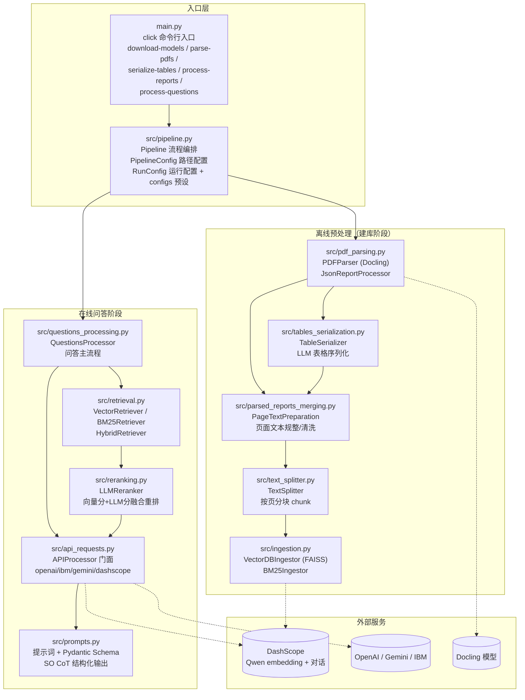
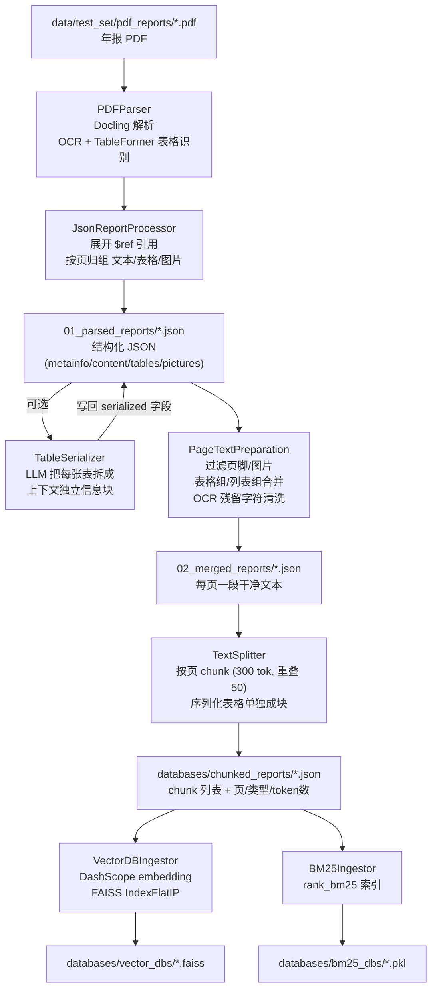
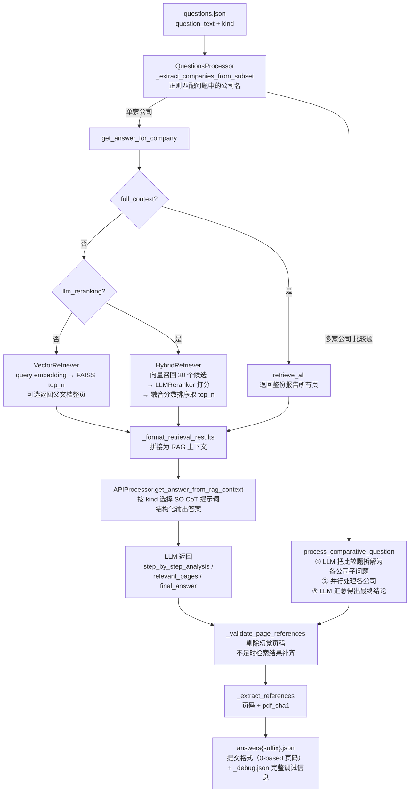
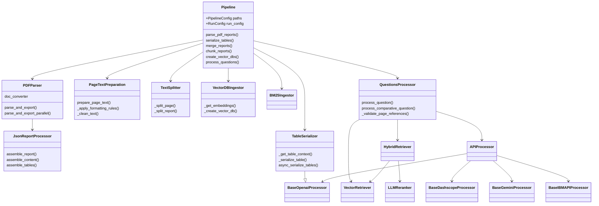
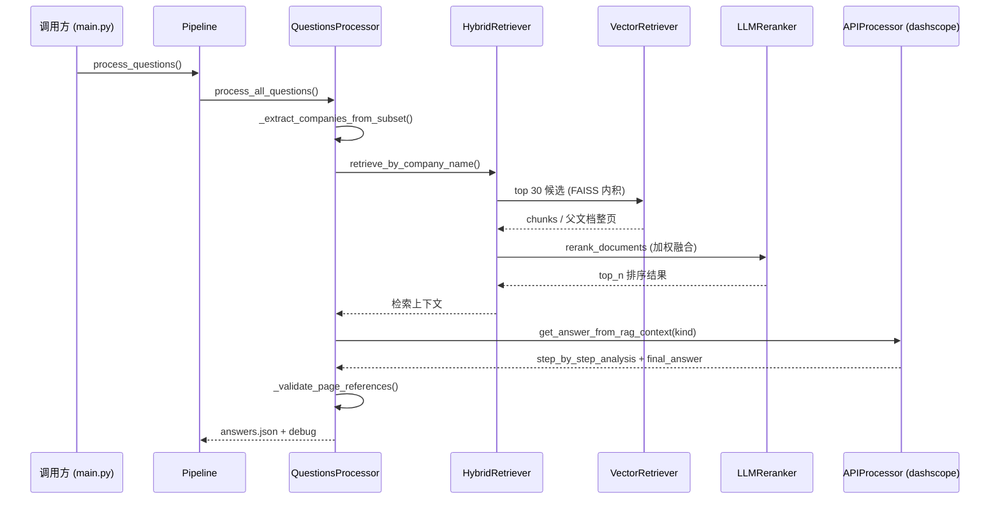

# RAG-Challenge-2 项目结构图与流程图

> 本文档配合源码中文注释使用，帮助你快速理解整体架构与数据流向。
> 所有图均为 Mermaid 代码，在支持 Mermaid 的 Markdown 阅读器（如 Typora、VS Code、GitHub）中可直接渲染；
> 同目录下的 `diagrams/` 文件夹中附有渲染好的 PNG 图片。

---

## 1. 总体架构图（模块结构）



---

## 2. 离线预处理流程图（建库 pipeline）

对应命令：`python main.py parse-pdfs` → `serialize-tables` → `process-reports`



> 说明：`03_reports_markdown` 是规整结果的 Markdown 导出，仅供人工复核（以及 `gemini_thinking` 全文配置使用），不参与主流程。

---

## 3. 在线问答流程图（process-questions）

对应命令：`python main.py process-questions --config max_nst_o3m`



---

## 4. 关键类关系图



---

## 5. 一问一答的数据流（以最佳配置 max_nst_o3m 为例）



---

## 6. 数据目录结构

```
data/test_set/
├── pdf_reports/            # 输入：年报 PDF（sha1 命名）
├── subset.csv              # 公司名 <-> sha1 映射（questions 路由的依据）
├── questions.json          # 问题列表（text + kind）
├── answers*.json           # 输出：提交格式答案
├── debug_data/
│   ├── 01_parsed_reports/      # Docling 解析后的结构化 JSON
│   ├── 01_parsed_reports_debug/ # Docling 原始导出（含元数据，调试用）
│   ├── 02_merged_reports/      # 规整后的每页文本
│   └── 03_reports_markdown/    # Markdown 导出（人工复核/全文模式）
└── databases/
    ├── chunked_reports/      # 分块后的 JSON（chunk 列表）
    └── vector_dbs/           # 每份报告一个 FAISS 索引
```
